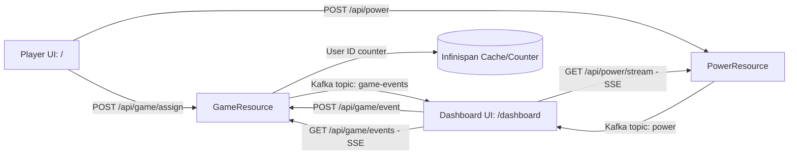

# AGENTS.md -- Quinoa WindTurbine Racer Project Guide

This guide contains project context, architecture, operational workflows, and testing rules for AI agents and developers working on `quinoa-wind-turbine`.

---

## 1. Project Overview

**Quinoa WindTurbine Racer** is a real-time multiplayer racing game demo combining:
* **Backend:** Quarkus (Java 25) with Reactive Messaging (Kafka), Infinispan (Clustered counters/state), REST endpoints, and Server-Sent Events (SSE).
* **Frontend:** React + Vite integrated seamlessly via the **Quarkus Quinoa** extension (`src/main/webui/`).
* **Simulation & Testing:** JBang load simulation (`scripts/GameLoader.java`) and Playwright E2E browser tests (`src/test/java/org/acme/RaceWebUITest.java`).

---

## 2. Architecture & Key Components



### Key Source Files & Endpoints
* **Player Assignment & Game State:** [`GameResource.java`](src/main/java/org/acme/GameResource.java:42)
  * `POST /api/game/assign` & `POST /api/game/assign/{id}?team={team}`: Registers players and increments Infinispan counter.
  * `GET /api/game/status`: Returns current game state (`empty`, `start`, `stop`, `reset`).
  * `GET /api/game/events`: SSE stream of game lifecycle events.
  * `POST /api/game/event`: Protected admin endpoint (role: `admin`) to broadcast game events.
* **Power & Racing Generation:** [`PowerResource.java`](src/main/java/org/acme/PowerResource.java:23)
  * `POST /api/power`: Receives player click/motion events.
  * `GET /api/power/stream`: SSE stream broadcasting aggregated power and car positions to the dashboard.
* **Frontend Single Page App:** [`src/main/webui/`](src/main/webui/)
  * `src/main/webui/src/components/Dashboard/`: Main operator race screen with live track, leaderboard, and play/reset controls.
  * `src/main/webui/src/components/GameController/`: Mobile player controller with team selection modal, wind turbine SVG, and tap/shake/swipe listeners.

---

## 3. Essential Commands & Development Workflow

### Starting Dev Mode
* **For AI Agents:** Use the **Quarkus Agent MCP** tool `quarkus_start` to manage dev mode and connect to Dev MCP tools automatically. Check status with `quarkus_status` and stop with `quarkus_stop`.
* **For Developers (CLI):** Run `./mvnw quarkus:dev`.

**Endpoints:**
* Player View: `http://localhost:8080/`
* Dashboard: `http://localhost:8080/dashboard`
* Dev UI: `http://localhost:8080/q/dev/`

### Load Testing & Performance Analysis
To run load tests and analyze system behavior:

1. **Start the application:**
   * Agent: Call MCP tool `quarkus_start`
   * CLI: Run `./mvnw quarkus:dev`
2. **Execute the load generator (JBang):**
   ```bash
   jbang scripts/GameLoader.java http://localhost:8080 --players 50 --clicks 100 --power 15
   ```
   * The script registers simulated players across both teams and polls `/api/game/status` until the game starts.
3. **Start the game:**
   * Open `http://localhost:8080/dashboard` in a browser (login: `developer` / `developer`), and click the **Play** button.
   * Alternatively, send a POST event using an authenticated admin session to `/api/game/event` with `{"type":"start"}`.
4. **Collect and analyze performance metrics:**
   * **Prometheus metrics:** `GET http://localhost:8080/metrics` (includes HTTP request latency, Kafka producer/consumer throughput, and Infinispan counter stats).
   * **Health & Liveness:** `GET http://localhost:8080/q/health`
   * **Micrometer timer / counts:** Search metrics for `http.server.requests`, `counted.user_assigned`, and Kafka messaging metrics.

---

## 4. Testing & Playwright Safety Rules

### Test Structure
1. **Unit / API Tests:** [`PowerResourceTest.java`](src/test/java/org/acme/PowerResourceTest.java:13) tests REST endpoints with RestAssured. Fast and lightweight.
2. **Browser E2E Tests:** [`RaceWebUITest.java`](src/test/java/org/acme/RaceWebUITest.java:34) tests full browser interactions (Playwright + Quinoa).
3. **Load Simulation:** [`scripts/GameLoader.java`](scripts/GameLoader.java:36) uses non-blocking Vert.x WebClient for traffic generation.

### CRITICAL: Playwright & Container Safety
* **NEVER run load tests using Playwright / browser instances:** Launching multiple headless Chromium instances (`Playwright.create()`) simultaneously consumes immense CPU/RAM and can crash the host system. Heavy traffic load simulation is strictly handled via `scripts/GameLoader.java`.
* `RaceWebUITest` is annotated with `@Tag("e2e")` and excluded from default test runs. To run it on demand, use `./mvnw test -Pe2e`.
* Keep Playwright tests scoped to low concurrency (e.g., 2–10 players) for E2E UI verification only.
* If tests time out or crash, clean up orphaned `chrome-headless-shell` processes and stopped Testcontainers (`Infinispan`, `Kafka`) to free system memory.

---

## 5. Agent Skills & MCP Configuration

### Project Skills & MCP Setup
* **MCP Server Config:** [`.mcp.json`](.mcp.json:1) defines the project-level Quarkus Agent MCP (`quarkus-agent` using JBang).
* **Load Testing Skill:** [`.agents/skills/wind-turbine-load-test/SKILL.md`](.agents/skills/wind-turbine-load-test/SKILL.md:1) provides automated procedures for running traffic simulations with JBang, starting races, and analyzing Prometheus metrics.

### Quarkus Extension & MCP Conventions
When adding or modifying Quarkus capabilities:
1. **Extension-First:** Search for matching Quarkus extensions (`quarkus_searchDocs` or `quarkus_searchTools query='extension'`) before writing custom boilerplate.
2. **Consult Skills:** Call `quarkus_skills` before implementing new features to review configuration properties and architectural patterns.
3. **Dev MCP Tools:** Use `quarkus_callTool` with `devui-testing_runTests` or `devui-testing_runTest` for running tests in dev mode.
4. **Never run `mvn clean` while dev mode is active:** It deletes `target/test-classes` and breaks the live test runner.
