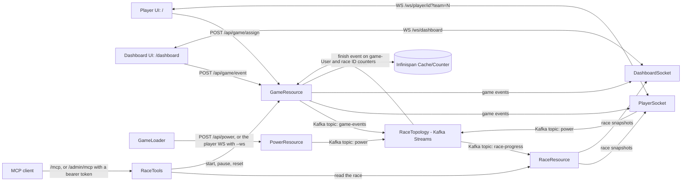

# AGENTS.md -- Quinoa WindTurbine Racer Project Guide

This guide contains project context, architecture, operational workflows, and testing rules for AI agents and developers working on `quinoa-wind-turbine`.

---

## 1. Project Overview

**Quinoa WindTurbine Racer** is a real-time multiplayer racing game demo combining:
* **Backend:** Quarkus (Java 25) with Reactive Messaging (Kafka), Infinispan (Clustered counters/state), REST endpoints, WebSockets Next for the phones and the dashboard, Server-Sent Events (SSE), and an MCP server (Quarkiverse `quarkus-mcp-server-http`) secured with OIDC bearer tokens from Keycloak.
* **Frontend:** React + Vite integrated seamlessly via the **Quarkus Quinoa** extension (`src/main/webui/`).
* **Simulation & Testing:** JBang load simulation (`scripts/GameLoader.java`) and Playwright E2E browser tests (`src/test/java/org/acme/RaceWebUITest.java`).

---

## 2. Architecture & Key Components



### Package layout
Code lives in feature packages under `src/main/java/org/acme/`, and tests mirror them under `src/test/java/org/acme/`.

| Package | Contents |
|---|---|
| `game` | Game lifecycle and player entry: `GameResource`, `GameConfig`, `PowerResource`, `PlayerSocket`, `DashboardSocket`, `CheatResource` |
| `race` | Race state and computation: `RaceTopology`, `RaceState`, `RaceResource`, `RaceModifier` |
| `commentary` | Live commentary: coordinator, trigger detection, feed, template and AI commentators |
| `theme` | Re-skinning: `ThemeService`, `ThemeValidator`, `PresetThemes`, `ThemeResource`, `UiConfigResource` |
| `halloffame` | Persisting and serving finished races |
| `admin` | MCP tools (`RaceTools`) and the admin login and token policies |

### Key Source Files & Endpoints
* **Player Assignment & Game State:** [`GameResource.java`](src/main/java/org/acme/game/GameResource.java)
  * `POST /api/game/assign` & `POST /api/game/assign/{id}?team={team}`: Registers players and increments Infinispan counter.
  * `GET /api/game/status`: Returns current game state (`empty`, `start`, `stop`, `reset`).
  * `GET /api/game/events`: SSE stream of game lifecycle events.
  * `POST /api/game/event`: Protected admin endpoint (role: `admin`) to broadcast game events.
* **Power & Racing Generation:** [`PowerResource.java`](src/main/java/org/acme/game/PowerResource.java)
  * `POST /api/power`: Receives player click/motion events.
* **Race computation:** [`RaceTopology.java`](src/main/java/org/acme/race/RaceTopology.java) is a Kafka Streams topology that computes per-player and per-team power, distance and finish order, publishes snapshots to the compacted `race-progress` topic and emits the `finish` game event. All race messages use key `race` on partition 0 so one Streams task owns the race. Rules come from `game.*` config ([`GameConfig.java`](src/main/java/org/acme/game/GameConfig.java)).
* **Race queries:** [`RaceResource.java`](src/main/java/org/acme/race/RaceResource.java) keeps a local copy of `race-progress` on every replica.
  * `GET /api/race/state`, `GET /api/race/leaderboard?team={team}`, `GET /api/race/stream` (SSE).
* **WebSockets:** [`PlayerSocket.java`](src/main/java/org/acme/game/PlayerSocket.java) and [`DashboardSocket.java`](src/main/java/org/acme/game/DashboardSocket.java) (WebSockets Next).
  * `/ws/player/{id}?team={team}`: the phone sends `{"quantity": N}` with the taps of the last 200 ms. The server sends `status` (game event), `standing` (team position and rank in team) and `notification` messages. An `HttpUpgradeCheck` rejects unknown IDs and teams with 400. Opening the connection registers the player, and each replica registers its connected players again after a reset.
  * `/ws/dashboard`: requires the `admin` role and a same-origin `Origin` header. Sends `race` snapshots and `game` events.
  * WebSockets Next doesn't cancel the `Multi` returned by `@OnOpen` when the connection closes, so every per-connection stream goes through `PlayerSocket.whileOpen`.
* **MCP server:** [`RaceTools.java`](src/main/java/org/acme/admin/RaceTools.java) defines tools on two servers.
  * `/mcp` (default server, no login): `get_race_state`, `get_leaderboard`, `get_player`, `get_hall_of_fame`, and the resource `race://current`, which notifies subscribers on every race update.
  * `/admin/mcp` (server `admin`): the same, plus `start_race`, `pause_race`, `reset_race`, `boost_team`, `list_preset_themes` and `apply_theme`. An HTTP permission requires a bearer token with the `admin` role. It isn't `@RolesAllowed` on the tools, because MCP clients only start their OAuth login on a 401.
  * Tokens come from the Keycloak realm `wind-turbine` (`src/main/resources/keycloak/wind-turbine-realm.json`, imported by Keycloak Dev Services). Users `developer` (admin) and `player`; clients `wind-turbine` (the app) and `mcp-agent` (public, PKCE, redirect `http://localhost:33418/callback`, direct grants in dev only). The app requires the audience `wind-turbine`.
  * Protected resource metadata: `/.well-known/oauth-protected-resource/admin/mcp`. OIDC is off by default in every mode. Enable admin MCP with `GAME_OIDC_ENABLED=true`; dev mode then starts Keycloak Dev Services, while deployments also need `GAME_OIDC_URL`. The dashboard's form login and read-only MCP work without Keycloak. Token tests enable OIDC through their own test profile.
  * On a cluster, a Quarkus redeploy replaces the deployment and drops variables set with `oc set env`, so re-apply `GAME_OIDC_ENABLED`/`GAME_OIDC_URL` after each redeploy. For an MCP agent that registers a client dynamically (Bob), the `wind-turbine` realm must carry the client-registration policies and `wind-turbine-audience` default scope from [`realm-import.yaml`](src/main/kubernetes/keycloak/realm-import.yaml) and no "Trusted Hosts" policy; a realm imported before those keeps Keycloak's strict default and rejects registration, and re-import is additive, so recreate it fresh. See the `wind-turbine-mcp-demo` skill for driving a cluster deployment.
  * The form-login paths (`/dashboard`, `/ws/dashboard`, `/api/game/event`) are pinned to the form mechanism, so anonymous requests still redirect to `/login`. Because of that, `@TestSecurity` doesn't reach them; tests log in with `AdminSession.login()`.
* **Hall of fame:** `HallOfFameWriter` persists each finished race to an Infinispan cache (one writer across replicas, elected over partition 0 of `race-progress` like the commentator), `HallOfFameStore` reads and writes it as JSON, and `HallOfFameResource` serves `GET /api/hall-of-fame`. The dashboard shows it between races.
* **Themes:** `ThemeService` holds the active theme and applies a new one between races by broadcasting a `theme` game event, so every replica and client switches together. `RaceTheme`/`ThemeValidator`/`PresetThemes` define and check the re-skin (team names, colors, cars); `ThemeResource` is the admin `POST /api/theme`; `UiConfigResource` serves the active theme and the AI flag. On the frontend, `ThemeContext.jsx` holds the live theme and `RaceTrack.jsx` draws either the painted default image (with hand-drawn lane paths) or a generated SVG track from `LanePath.js`.
* **Frontend Single Page App:** [`src/main/webui/`](src/main/webui/)
  * `src/main/webui/src/components/Dashboard/`: Main operator race screen with live track, leaderboard, and play/reset controls. It renders the server's race state and doesn't compute the race itself.
  * `src/main/webui/src/components/GameController/`: Mobile player controller with team selection modal, wind turbine SVG, and tap/shake/swipe listeners. It talks to the server over the player WebSocket (`src/main/webui/src/api/PlayerSocket.js`).

---

## 3. Essential Commands & Development Workflow

### Starting Dev Mode
* **For AI Agents:** Use the **Quarkus Agent MCP** tool `quarkus_start` to manage dev mode and connect to Dev MCP tools automatically. Check status with `quarkus_status` and stop with `quarkus_stop`.
* **For Developers (CLI):** Run `./mvnw quarkus:dev`.

**Endpoints:**
* Player View: `http://localhost:8080/`
* Dashboard: `http://localhost:8080/dashboard`
* Dev UI: `http://localhost:8080/q/dev/`

### Load Testing & Performance Analysis
To run load tests and analyze system behavior:

1. **Start the application:**
   * Agent: Call MCP tool `quarkus_start`
   * CLI: Run `./mvnw quarkus:dev`
2. **Execute the load generator (JBang):**
   ```bash
   jbang scripts/GameLoader.java http://localhost:8080 --players 12 --clicks 600 --power 10 --interval 75 --ws
   ```
   * The script registers simulated players across both teams and waits for the game to start before sending clicks.
   * `--power` is the **maximum** per click; actual values are random in `[1, power]`, so players diverge naturally.
   * `--interval` controls milliseconds between click batches (default 200). Use `--interval 75` for ~20s races, `--interval 100` for ~45s races.
   * `--ws` sends clicks over the player WebSocket instead of `POST /api/power` (recommended).
   * Over WebSockets (`--ws`), the loader taps until the race finishes, so `--clicks` is only a safety cap. Each click is a random 1..power (about `power/2`), so finishing needs roughly `3000 / power` batches; the default cap (500) covers the usual powers. Without `--ws` there's no finish detection, so size `--clicks` to at least `3000 / power`.
3. **Start the game:**
   * Open `http://localhost:8080/dashboard` in a browser (dev mode login: `developer` / `developer`, configured by `game.admin.*` in [`GameConfig.java`](src/main/java/org/acme/game/GameConfig.java) and checked by [`AdminIdentityProvider.java`](src/main/java/org/acme/admin/AdminIdentityProvider.java)), and click the **Play** button.
   * Alternatively, send a POST event using an authenticated admin session to `/api/game/event` with `{"type":"start"}`.
4. **Collect and analyze performance metrics:**
   * **Prometheus metrics:** `GET http://localhost:8080/metrics` (includes HTTP request latency, Kafka producer/consumer throughput, and Infinispan counter stats).
   * **Health & Liveness:** `GET http://localhost:8080/q/health`
   * **Micrometer timer / counts:** Search metrics for `http.server.requests`, `counted.user_assigned`, and Kafka messaging metrics.

---

## 4. Testing & Playwright Safety Rules

### Test Structure
1. **Unit / API Tests:** [`PowerResourceTest.java`](src/test/java/org/acme/game/PowerResourceTest.java) and [`RaceResourceTest.java`](src/test/java/org/acme/race/RaceResourceTest.java) test REST endpoints with RestAssured against Dev Services. [`RaceTopologyTest.java`](src/test/java/org/acme/race/RaceTopologyTest.java) tests the Kafka Streams topology with `TopologyTestDriver`, without a broker. [`RaceToolsTest.java`](src/test/java/org/acme/admin/RaceToolsTest.java) tests both MCP endpoints with `McpAssured` and real tokens from Keycloak Dev Services.
2. **Browser E2E Tests:** [`RaceWebUITest.java`](src/test/java/org/acme/RaceWebUITest.java:34) tests full browser interactions (Playwright + Quinoa).
3. **Optional tests:** the AI commentary tests (`AiCommentatorTest`, with a local OpenAI stub) and the cheat endpoint tests (`CheatResourceTest`) are tagged `@Tag("optional")`. Each needs its own app boot, so the default run skips them. Run them with `./mvnw test -Poptional`. Every `@TestProfile` restarts the app and its Dev Services, so reuse an existing profile before adding one.
4. **Load Simulation:** [`scripts/GameLoader.java`](scripts/GameLoader.java:36) uses non-blocking Vert.x WebClient for traffic generation.

### CRITICAL: Playwright & Container Safety
* **NEVER run load tests using Playwright / browser instances:** Launching multiple headless Chromium instances (`Playwright.create()`) simultaneously consumes immense CPU/RAM and can crash the host system. Heavy traffic load simulation is strictly handled via `scripts/GameLoader.java`.
* `RaceWebUITest` is annotated with `@Tag("e2e")` and excluded from default test runs. To run it on demand, use `./mvnw test -Pe2e`.
* Keep Playwright tests scoped to low concurrency (e.g., 2–10 players) for E2E UI verification only.
* If tests time out or crash, clean up orphaned `chrome-headless-shell` processes and stopped Testcontainers (`Infinispan`, `Kafka`) to free system memory.

---

## 5. Agent Skills & MCP Configuration

### Project Skills & MCP Setup
* **MCP Server Config:** [`.mcp.json`](.mcp.json:1) (Claude Code / Cursor) and [`.bob/mcp.json`](.bob/mcp.json:1) (Bob) define the project-level game MCP servers, `wind-turbine-race` (`/mcp`) and `wind-turbine-admin` (`/admin/mcp`). These connect while dev mode runs.
* **Quarkus Agent MCP (Bob only):** The `quarkus-agent` server is **not** in `.bob/mcp.json` because it requires machine-specific paths (`jbang` and `JAVA_HOME`) that Bob does not expand from environment variables. Add it once to your global Bob config (`~/.bob/settings/mcp.json`) with absolute paths for your machine:
  ```json
  "quarkus-agent": {
    "command": "/path/to/jbang",
    "args": ["quarkus-agent-mcp@quarkusio"],
    "env": {
      "JAVA_HOME": "/path/to/java21+"
    }
  }
  ```
  For sdkman users: `command` = `~/.sdkman/candidates/jbang/current/bin/jbang` (expand `~` to your home dir), `JAVA_HOME` = `~/.sdkman/candidates/java/current`.
* **Load Testing Skill:** [`.agents/skills/wind-turbine-load-test/SKILL.md`](.agents/skills/wind-turbine-load-test/SKILL.md:1) provides automated procedures for running traffic simulations with JBang, starting races, and analyzing Prometheus metrics.
* **MCP Demo Skill:** [`.agents/skills/wind-turbine-mcp-demo/SKILL.md`](.agents/skills/wind-turbine-mcp-demo/SKILL.md:1) covers driving a race through the game's MCP servers: the login steps only the user can do, getting simulated players in with `GameLoader --ws`, pacing a race for a 50% milestone, and an HTTP fallback without MCP tools. When asked to start the game, check the admin MCP login first; if it hasn't happened, tell the user to authenticate and wait for their confirmation instead of working around it.
* Skills live in `.agents/skills/`. `.claude/skills` is a symlink to it, so Claude Code finds the same skills as agents that read `.agents/`.

### Quarkus Extension & MCP Conventions
When adding or modifying Quarkus capabilities:
1. **Extension-First:** Search for matching Quarkus extensions (`quarkus_searchDocs` or `quarkus_searchTools query='extension'`) before writing custom boilerplate.
2. **Consult Skills:** Call `quarkus_skills` before implementing new features to review configuration properties and architectural patterns.
3. **Dev MCP Tools:** Use `quarkus_callTool` with `devui-testing_runTests` or `devui-testing_runTest` for running tests in dev mode.
4. **Never run `mvn clean` while dev mode is active:** It deletes `target/test-classes` and breaks the live test runner.

<!-- groma:start -->
## Groma

This project uses Groma. Before you scan, inspect, or curate architecture, or change files for a Backlog task, run `groma agent-instructions` and read the guide it names for that job. When it reports a first scan, ask the user whether they want you to curate the architecture. Do not edit Groma-owned architecture files directly.
<!-- groma:end -->
