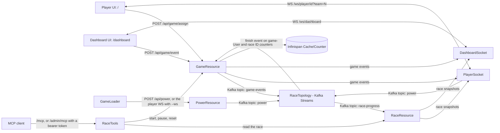

# AGENTS.md -- Quinoa WindTurbine Racer Project Guide

This guide contains project context, architecture, operational workflows, and testing rules for AI agents and developers working on `quinoa-wind-turbine`.

---

## 1. Project Overview

**Quinoa WindTurbine Racer** is a real-time multiplayer racing game demo combining:
* **Backend:** Quarkus (Java 25) with Reactive Messaging (Kafka), Infinispan (Clustered counters/state), REST endpoints, WebSockets Next for the phones and the dashboard, Server-Sent Events (SSE), and an MCP server (Quarkiverse `quarkus-mcp-server-http`) secured with OIDC bearer tokens from Keycloak.
* **Frontend:** React + Vite integrated seamlessly via the **Quarkus Quinoa** extension (`src/main/webui/`).
* **Simulation & Testing:** JBang load simulation (`scripts/GameLoader.java`) and Playwright E2E browser tests (`src/test/java/org/acme/RaceWebUITest.java`).

---

## 2. Architecture & Key Components



### Package layout
Code lives in feature packages under `src/main/java/org/acme/`, and tests mirror them under `src/test/java/org/acme/`.

| Package | Contents |
|---|---|
| `game` | Game lifecycle and player entry: `GameResource`, `GameConfig`, `PowerResource`, `PlayerSocket`, `DashboardSocket`, `CheatResource` |
| `race` | Race state and computation: `RaceTopology`, `RaceState`, `RaceResource`, `RaceModifier` |
| `commentary` | Live commentary: coordinator, trigger detection, feed, template and AI commentators |
| `theme` | Re-skinning: `ThemeService`, `ThemeValidator`, `PresetThemes`, `ThemeResource`, `UiConfigResource` |
| `halloffame` | Persisting and serving finished races |
| `admin` | MCP tools (`RaceTools`) and the admin login and token policies |

### Key Source Files & Endpoints
* **Player Assignment & Game State:** [`GameResource.java`](src/main/java/org/acme/game/GameResource.java)
  * `POST /api/game/assign` & `POST /api/game/assign/{id}?team={team}`: Registers players and increments Infinispan counter.
  * `GET /api/game/status`: Returns current game state (`empty`, `start`, `stop`, `reset`).
  * `GET /api/game/events`: SSE stream of game lifecycle events.
  * `POST /api/game/event`: Protected admin endpoint (role: `admin`) to broadcast game events.
* **Power & Racing Generation:** [`PowerResource.java`](src/main/java/org/acme/game/PowerResource.java)
  * `POST /api/power`: Receives player click/motion events.
* **Race computation:** [`RaceTopology.java`](src/main/java/org/acme/race/RaceTopology.java) is a Kafka Streams topology that computes per-player and per-team power, distance and finish order, publishes snapshots to the compacted `race-progress` topic and emits the `finish` game event. All race messages use key `race` on partition 0 so one Streams task owns the race. Rules come from `game.*` config ([`GameConfig.java`](src/main/java/org/acme/game/GameConfig.java)).
* **Race queries:** [`RaceResource.java`](src/main/java/org/acme/race/RaceResource.java) keeps a local copy of `race-progress` on every replica.
  * `GET /api/race/state`, `GET /api/race/leaderboard?team={team}`, `GET /api/race/stream` (SSE).
* **WebSockets:** [`PlayerSocket.java`](src/main/java/org/acme/game/PlayerSocket.java) and [`DashboardSocket.java`](src/main/java/org/acme/game/DashboardSocket.java) (WebSockets Next).
  * `/ws/player/{id}?team={team}`: the phone sends `{"quantity": N}` with the taps of the last 200 ms. The server sends `status` (game event), `standing` (team position and rank in team) and `notification` messages. An `HttpUpgradeCheck` rejects unknown IDs and teams with 400. Opening the connection registers the player, and each replica registers its connected players again after a reset.
  * `/ws/dashboard`: requires the `admin` role and a same-origin `Origin` header. Sends `race` snapshots and `game` events.
  * WebSockets Next doesn't cancel the `Multi` returned by `@OnOpen` when the connection closes, so every per-connection stream goes through `PlayerSocket.whileOpen`.
* **MCP server:** [`RaceTools.java`](src/main/java/org/acme/admin/RaceTools.java) defines tools on two servers.
  * `/mcp` (default server, no login): `get_race_state`, `get_leaderboard`, `get_player`, `get_hall_of_fame`, `get_active_theme`, the resource `race://current`, which notifies subscribers on every race update, and the prompts `race_briefing` and `race_recap`.
  * `/admin/mcp` (server `admin`): the same, plus `start_race`, `pause_race`, `reset_race`, `boost_team`, `reset_hall_of_fame`, `set_input_mode`, `set_commentary_style`, `list_preset_themes`, `apply_theme`, the `theme_idea` prompt, and, when AI is enabled, `suggest_team_names` and `generate_theme`. An HTTP permission requires a bearer token with the `admin` role. It isn't `@RolesAllowed` on the tools, because MCP clients only start their OAuth login on a 401.
  * The prompts own their wording and fill in server state (`@Prompt`, `@PromptArg`, `@CompletePrompt`): `race_briefing` takes a commentary `style` and an optional `focus` and returns the rules plus the live race JSON; `race_recap` takes a `raceId` and `tone` and returns the hall-of-fame entry, or the race in progress when nothing has finished; `theme_idea` takes an `event` and `audience` and returns a design brief ending in `apply_theme`. They only read state.
  * Tokens come from the Keycloak realm `wind-turbine` (`src/main/resources/keycloak/wind-turbine-realm.json`, imported by Keycloak Dev Services). Users `developer` (admin) and `player`; clients `wind-turbine` (the app) and `mcp-agent` (public, PKCE, redirect `http://localhost:33418/callback`, direct grants in dev only). The app requires the audience `wind-turbine`. Dev Services uses the container name `wind-turbine`, so it creates its own container instead of attaching to another project's Keycloak when container reuse is enabled; the realm in a shared container doesn't match the file.
  * Protected resource metadata: `/.well-known/oauth-protected-resource/admin/mcp`. OIDC is off by default in every mode. Enable admin MCP with `GAME_OIDC_ENABLED=true` or the same setting as a system property, `-Dquarkus.oidc.tenant-enabled=true`; dev mode then starts Keycloak Dev Services, while deployments also need `GAME_OIDC_URL`. The dashboard's form login and read-only MCP work without Keycloak. Token tests enable OIDC through their own test profile.
  * On a cluster, a Quarkus redeploy replaces the deployment and drops variables set with `oc set env`, so re-apply `GAME_OIDC_ENABLED`/`GAME_OIDC_URL` after each redeploy. For an MCP agent that registers a client dynamically (Bob), the `wind-turbine` realm must carry the client-registration policies and `wind-turbine-audience` default scope from [`realm-import.yaml`](src/main/kubernetes/keycloak/realm-import.yaml) and no "Trusted Hosts" policy; a realm imported before those keeps Keycloak's strict default and rejects registration. Keycloak's single-file realm import skips an existing realm wholesale (the import job logs `Realm already exists. Import skipped`), so changes to an imported realm never land through re-import — either recreate the realm fresh or change it through the Admin API. `scripts/deploy-openshift.sh` creates the realm through the Admin API (`POST /admin/realms` with `spec.realm` rendered from [`realm-import.yaml`](src/main/kubernetes/keycloak/realm-import.yaml)), because on Keycloak 26.4 a realm written by the import job gets none of the `<realm>-realm` client roles that make up the master admin's rights, and every Admin API call against it then answers 403, including delete. A realm created through the API grants its creator those roles. The script then ensures the `race-ops` client and grants the `admin` role to its service account on every run. That role cannot live in the realm file: Keycloak imports users before clients, so a declared `service-account-race-ops` user collides with the one the client creation makes and the import job fails on the `(realm_id, username)` unique constraint. See the `wind-turbine-mcp-demo` skill for driving a cluster deployment.
  * Locally, a dev realm can keep Keycloak's default "Trusted Hosts" client-registration policy, which the repo realm file doesn't declare, and then Bob's registration fails with `Policy 'Trusted Hosts' rejected request`. Keycloak refuses that policy with both checks off, so the file can't disable it; run [`scripts/open-dev-registration.sh`](scripts/open-dev-registration.sh) to delete it from the running realm.
  * The form-login paths (`/dashboard`, `/ws/dashboard`, `/api/game/event`) are pinned to the form mechanism, so anonymous requests still redirect to `/login`. Because of that, `@TestSecurity` doesn't reach them; tests log in with `AdminSession.login()`.
* **Hall of fame:** `HallOfFameWriter` persists each finished race to an Infinispan cache (one writer across replicas, elected over partition 0 of `race-progress` like the commentator), `HallOfFameStore` reads and writes it as JSON and clears it for the admin `reset_hall_of_fame` tool, and `HallOfFameResource` serves `GET /api/hall-of-fame`. The dashboard shows it between races.
* **Themes:** `ThemeService` holds the active theme and applies a new one between races (enforced: mid-race applies are rejected) by broadcasting a `theme` game event, so every replica and client switches together. Applying while a finished heat is still on the board resets that heat first, because its players and winner stay in the race state until a reset and would otherwise wear the next heat's names; `RaceApi.consume` also holds the restyle until the board clears, for the gap between the reset event and its snapshot. `RaceTheme`/`ThemeValidator`/`PresetThemes` define and check the re-skin (team names, colors, cars); `ThemeResource` is the admin `POST /api/theme` plus presets, and, with `game.ai.enabled`, `POST /api/theme/suggest-names` and `/api/theme/generate` backed by `ThemeGeneratorAi` on its own named model config (`quarkus.langchain4j.openai.theme.*`); `UiConfigResource` serves the active theme and the AI flag. On the frontend, `ThemeContext.jsx` holds the live theme, `ThemePanel.jsx` is the operator's between-races control, and `RaceTrack.jsx` draws either the painted default image (with hand-drawn lane paths) or a generated SVG track from `LanePath.js`.
* **Input mode:** `org.acme.input.InputModeService` holds how players drive the windmill (`tap`, `shake` or `both`, enum `InputMode`). The default is `game.input.mode` (`tap`) until the first switch; the active mode is stored in Infinispan (persistent cache with in-memory fallback, like the hall of fame), so every replica agrees and it survives an app restart when the Infinispan server keeps its data, unlike the per-pod theme. Dev Services starts a fresh Infinispan container on each dev start, so there the mode resets to the default (observed; the cluster case is unverified). Applying is rejected mid-race (status `start` or `pause`), through the admin MCP tool `set_input_mode`, and broadcasts an `input-mode` game event that doesn't count as the last game event. `GET /api/config` returns `inputMode`. On the frontend, `InputModeContext.jsx` holds it, `inputMode.js` maps it to `{ tap, shake }` (tap-only on devices without `DeviceMotionEvent`), and phones re-read `/api/config` on every player socket open and on the event. `ENABLE_BLOWING`/`ENABLE_SWIPING` remain `Config.js` flags; `ENABLE_TAPPING`/`ENABLE_SHAKING` no longer exist.
* **Frontend Single Page App:** [`src/main/webui/`](src/main/webui/)
  * `src/main/webui/src/components/Dashboard/`: Main operator race screen with live track, leaderboard, and play/reset controls. It renders the server's race state and doesn't compute the race itself. `DirectorConsole.jsx` is the race-ops agent's status and approval cards, polling race-ops and hiding itself when it is down (`game.ops.enabled`).
  * `src/main/webui/src/components/GameController/`: Mobile player controller with team selection modal, wind turbine SVG, and tap/shake/swipe listeners. It talks to the server over the player WebSocket (`src/main/webui/src/api/PlayerSocket.js`).
* **Race director and the A2A mesh (subprojects, own poms):** `race-ops` operates the event through the game's admin MCP server and calls two specialists over A2A. `race-analyst` (port 8082) computes the engagement report from two snapshots in plain code. `race-creative` (port 8083) is the LLM agent whose tools are the game's theme tools. Every director decision goes through one supervisor that has both specialists as sub-agents. Mid-race the analyst runs first and the model decides from its diagnosis whether the director boosts (return `done`, the analyst's sentence becomes the card's reason) or the creative director proposes a look for the next heat; nothing in the request pre-writes that choice, and the route is read from which specialist answered, never from model text. Between heats the same entry point gets a standing order to call the creative director. The planner is steered only through `supervisorContext`: the framework builds its system message itself, so an `@SystemMessage` on the supervisor is ignored. The payload travels as a typed argument the routing model cannot rewrite; only the choice of specialist comes from it. A next-heat look needs 30% of the trailing team stopped tapping, and a decision whose race stopped running is dropped; a theme approved mid-heat is queued and applied after the finish. The creative agent is also gated structurally by an `@ActivationCondition`, so the planner is never offered it on a soft-tapping diagnosis. The analyst is also called directly for the console's engagement numbers, and an approved theme executes directly. Both specialists are single-tenant A2A apps with `a2a.authorization.required=false`, and both have no route on the cluster. Every mesh call has an in-process fallback, so a stopped specialist never blocks the race. On the cluster the specialists are reached on their Service port 80, the MCP protocol is pinned to `2026-07-28` on both clients (stateless requests, `_meta` and `Mcp-Method` per call, no session), and the subsidiary SSE channel is off because an edge route 504s the idle stream of the legacy protocol; a decision waits 15 s mid-race and 40 s between heats. See [race-ops/README.md](race-ops/README.md), [race-analyst/README.md](race-analyst/README.md) and [race-creative/README.md](race-creative/README.md).

---

## 3. Essential Commands & Development Workflow

### Starting Dev Mode

Use [`scripts/DevMode.java`](scripts/DevMode.java) for every local start. It is a JBang script
that starts the services in the order they need and waits for the readiness endpoint of each one
before starting the next.

**When the user asks to start the game locally, run `jbang scripts/DevMode.java start`.** That is
the full mode (`mesh`), and it is what the demo and the director need. Don't bring the four
services up with four separate `quarkus_start` calls.

```bash
jbang scripts/DevMode.java start                    # mesh (default): game, analyst, creative, race-ops
jbang scripts/DevMode.java start ops                # game and race-ops, no specialists
jbang scripts/DevMode.java start oidc               # game only, with Keycloak and /admin/mcp
jbang scripts/DevMode.java start bare               # game only, no Keycloak
jbang scripts/DevMode.java start mesh --players 8   # plus GameLoader with 8 simulated players
jbang scripts/DevMode.java status
jbang scripts/DevMode.java logs ops
jbang scripts/DevMode.java stop
```

* OIDC is off unless something switches it on, so `oidc`, `ops` and `mesh` set `GAME_OIDC_ENABLED=true`
  for the game. They then require `/admin/mcp` to answer **401**, which is how they know Keycloak Dev
  Services came up. `bare` skips that check and is the only mode without Keycloak — use it only when
  the user asks for a start without auth.
* `start` skips a service whose port already answers and says so, so re-running it after a partial
  failure is safe.
* Logs go to `target/dev-mode/<service>.log`. `stop` terminates the whole process tree, which
  sidesteps the MCP client that blocks on close during a dev-mode reload: never hot-reload race-ops
  or race-creative while their MCP client is connected, stop and start instead.
* A start made by the script is outside the Quarkus Agent MCP's control: `quarkus_stop` doesn't
  reach it, `jbang scripts/DevMode.java stop` does.

`quarkus_start` still works for the game alone, which is the fastest loop when you are only changing
the game: pass `extraArgs: "-Dquarkus.oidc.tenant-enabled=true"`, and keep that argument with the
instance, so `quarkus_restart` and dev-mode reloads stay authenticated. `extraArgs` is split on
whitespace, so a value containing a space can't go through it; nothing in this project needs one.
The CLI equivalents are `GAME_OIDC_ENABLED=true ./mvnw quarkus:dev` and
`./mvnw quarkus:dev -Dquarkus.oidc.tenant-enabled=true`.

> **CRITICAL — verify OIDC is active after any start the script did not make:**
> After `quarkus_start` or a manual `./mvnw quarkus:dev`, confirm OIDC loaded by running:
> `curl -s -o /dev/null -w "%{http_code}" -X POST http://localhost:8080/admin/mcp`
> The response **must be `401`**. A `403` means the app started **without** the OIDC flag — Keycloak Dev Services did not spin up. If you see 403, stop immediately with `quarkus_stop` and restart with `GAME_OIDC_ENABLED=true ./mvnw quarkus:dev` via CLI (the env var is the most reliable path). Do **not** attempt multiple `quarkus_start` retries with different profiles or args — they all ignore the env var and will fail the same way.

**Endpoints:**
* Player View: `http://localhost:8080/`
* Dashboard: `http://localhost:8080/dashboard`
* Dev UI: `http://localhost:8080/q/dev/`
* race-ops (the director subproject, own pom): dev mode on `http://localhost:8081/`, ops page at `/ops.html`, Prometheus metrics at `/metrics`, build and test with `./mvnw -f race-ops/pom.xml ...`. See [race-ops/README.md](race-ops/README.md).
* race-analyst (the analyst specialist, own pom): A2A on `http://localhost:8082/`, card at `/.well-known/agent-card.json`, tests with `./mvnw -f race-analyst/pom.xml test`. See [race-analyst/README.md](race-analyst/README.md).
* race-creative (the creative specialist, own pom): A2A on `http://localhost:8083/`, card at `/.well-known/agent-card.json`, tests with `./mvnw -f race-creative/pom.xml test`. See [race-creative/README.md](race-creative/README.md).
* Full mesh start order: game, then race-analyst, then race-creative, then race-ops. race-ops also runs alone; `race-ops.mesh-enabled=false` keeps it from building the A2A clients at all.

### Load Testing & Performance Analysis
To run load tests and analyze system behavior:

1. **Start the application:**
   * Agent: Call MCP tool `quarkus_start` with `extraArgs: "-Dquarkus.oidc.tenant-enabled=true -Dquarkus.http.host=0.0.0.0"`
   * CLI: Run `GAME_OIDC_ENABLED=true ./mvnw quarkus:dev -Dquarkus.http.host=0.0.0.0`
   * `-Dquarkus.http.host=0.0.0.0` is needed when the reShapr containers must reach the
     game (see [`reshapr/README.md`](reshapr/README.md)); plain localhost works otherwise.
2. **Execute the load generator (JBang):**
   ```bash
   jbang scripts/GameLoader.java http://localhost:8080 --players 12 --clicks 600 --power 10 --interval 75 --ws
   ```
   * The script registers simulated players across both teams and waits for the game to start before sending clicks.
   * `--power` is the **maximum** per click; actual values are random in `[1, power]`, so players diverge naturally.
   * `--interval` controls milliseconds between click batches (default 200). Use `--interval 75` for ~20s races, `--interval 100` for ~45s races.
   * `--ws` sends clicks over the player WebSocket instead of `POST /api/power` (recommended).
   * Over WebSockets (`--ws`), the loader taps until the race finishes, so `--clicks` is only a safety cap. Each click is a random 1..power (about `power/2`), so finishing needs roughly `3000 / power` batches; the default cap (500) covers the usual powers. Without `--ws` there's no finish detection, so size `--clicks` to at least `3000 / power`.
3. **Start the game:**
   * Open `http://localhost:8080/dashboard` in a browser (dev mode login: `developer` / `developer`, configured by `game.admin.*` in [`GameConfig.java`](src/main/java/org/acme/game/GameConfig.java) and checked by [`AdminIdentityProvider.java`](src/main/java/org/acme/admin/AdminIdentityProvider.java)), and click the **Play** button.
   * Alternatively, send a POST event using an authenticated admin session to `/api/game/event` with `{"type":"start"}`.
4. **Collect and analyze performance metrics:**
   * **Prometheus metrics:** `GET http://localhost:8080/metrics` (includes HTTP request latency, Kafka producer/consumer throughput, and Infinispan counter stats).
   * **Health & Liveness:** `GET http://localhost:8080/q/health`
   * **Micrometer timer / counts:** Search metrics for `http.server.requests`, `counted.user_assigned`, and Kafka messaging metrics.

---

## 4. Testing & Playwright Safety Rules

### Test Structure
1. **Unit / API Tests:** [`PowerResourceTest.java`](src/test/java/org/acme/game/PowerResourceTest.java) and [`RaceResourceTest.java`](src/test/java/org/acme/race/RaceResourceTest.java) test REST endpoints with RestAssured against Dev Services. [`RaceTopologyTest.java`](src/test/java/org/acme/race/RaceTopologyTest.java) tests the Kafka Streams topology with `TopologyTestDriver`, without a broker. [`RaceToolsTest.java`](src/test/java/org/acme/admin/RaceToolsTest.java) tests both MCP endpoints with `McpAssured` and real tokens from Keycloak Dev Services.
2. **Browser E2E Tests:** [`RaceWebUITest.java`](src/test/java/org/acme/RaceWebUITest.java:34) tests full browser interactions (Playwright + Quinoa).
3. **Optional tests:** the AI commentary tests (`AiCommentatorTest`, with a local OpenAI stub) and the cheat endpoint tests (`CheatResourceTest`) are tagged `@Tag("optional")`. Each needs its own app boot, so the default run skips them. Run them with `./mvnw test -Poptional`. Every `@TestProfile` restarts the app and its Dev Services, so reuse an existing profile before adding one.
4. **Load Simulation:** [`scripts/GameLoader.java`](scripts/GameLoader.java:36) uses non-blocking Vert.x WebClient for traffic generation.
5. **Subproject tests:** each of the three subprojects builds and tests with its own pom, and none of them talks to a running game or model in the default run. `./mvnw -f race-ops/pom.xml test` (93 tests) covers the director, the mesh wiring and the console API with the game and mesh flags off. `./mvnw -f race-analyst/pom.xml test` (15) and `./mvnw -f race-creative/pom.xml test` (23) boot each A2A app on a random port and send real `SendMessage` tasks. Stop a dev-mode app before running `mvn test` on the same project, because the compile triggers a reload and race-ops or race-creative with a live MCP connection dies on reload.

### CRITICAL: Playwright & Container Safety
* **NEVER run load tests using Playwright / browser instances:** Launching multiple headless Chromium instances (`Playwright.create()`) simultaneously consumes immense CPU/RAM and can crash the host system. Heavy traffic load simulation is strictly handled via `scripts/GameLoader.java`.
* `RaceWebUITest` is annotated with `@Tag("e2e")` and excluded from default test runs. To run it on demand, use `./mvnw test -Pe2e`.
* Keep Playwright tests scoped to low concurrency (e.g., 2–10 players) for E2E UI verification only.
* If tests time out or crash, clean up orphaned `chrome-headless-shell` processes and stopped Testcontainers (`Infinispan`, `Kafka`) to free system memory.

---

## 5. Agent Skills & MCP Configuration

### Project Skills & MCP Setup
* **MCP Server Config:** [`.mcp.json`](.mcp.json:1) (Claude Code / Cursor) and [`.bob/mcp.json`](.bob/mcp.json:1) (Bob) define the project-level game MCP servers, `wind-turbine-race` (`/mcp`) and `wind-turbine-admin` (`/admin/mcp`). These connect while dev mode runs.
* **Quarkus Agent MCP (Bob only):** The `quarkus-agent` server is **not** in `.bob/mcp.json` because it requires machine-specific paths (`jbang` and `JAVA_HOME`) that Bob does not expand from environment variables. Add it once to your global Bob config (`~/.bob/settings/mcp.json`) with absolute paths for your machine:
  ```json
  "quarkus-agent": {
    "command": "/path/to/jbang",
    "args": ["quarkus-agent-mcp@quarkusio"],
    "env": {
      "JAVA_HOME": "/path/to/java21+"
    }
  }
  ```
  For sdkman users: `command` = `~/.sdkman/candidates/jbang/current/bin/jbang` (expand `~` to your home dir), `JAVA_HOME` = `~/.sdkman/candidates/java/current`.
* **Load Testing Skill:** [`.agents/skills/wind-turbine-load-test/SKILL.md`](.agents/skills/wind-turbine-load-test/SKILL.md:1) provides automated procedures for running traffic simulations with JBang, starting races, and analyzing Prometheus metrics.
* **MCP Demo Skill:** [`.agents/skills/wind-turbine-mcp-demo/SKILL.md`](.agents/skills/wind-turbine-mcp-demo/SKILL.md:1) covers driving a race through the game's MCP servers.

> **MANDATORY — activate the MCP demo skill before every race:**
> Whenever the user asks to start, run, load players, demo, or watch a race, call `use_skill("wind-turbine-mcp-demo")` **before taking any action**. Do not skip this even if you think you remember the rules — the skill contains critical race-running instructions (polling loop, secret Ferrari boost at 65%, IBM logo on Ferrari, OIDC verification) that must be re-read every time. Skipping the skill activation is the direct cause of missed boosts, missing logos, no live updates, and improper race flow.

* Skills live in `.agents/skills/`. `.claude/skills` is a symlink to it, so Claude Code finds the same skills as agents that read `.agents/`.

### Quarkus Extension & MCP Conventions
When adding or modifying Quarkus capabilities:
1. **Extension-First:** Search for matching Quarkus extensions (`quarkus_searchDocs` or `quarkus_searchTools query='extension'`) before writing custom boilerplate.
2. **Consult Skills:** Call `quarkus_skills` before implementing new features to review configuration properties and architectural patterns.
3. **Dev MCP Tools:** Use `quarkus_callTool` with `devui-testing_runTests` or `devui-testing_runTest` for running tests in dev mode.
4. **Never run `mvn clean` while dev mode is active:** It deletes `target/test-classes` and breaks the live test runner.

## 6. Known issues

Carried over from the retired feature roadmap (`docs/roadmap.md`, deleted once all three
features shipped); only still-true items remain.

- **The active theme lives in memory per pod** (`ThemeService` holds an
  `AtomicReference`): a pod that starts after a theme change serves the configured
  default until the next theme event. All running pods switch together on the
  broadcast; only restarts lose it.
- **A pod that starts mid-race reports status `empty`**: the `game-events-in` consumer
  starts at the `latest` offset (earliest only in tests), so game status stays empty
  until the next event arrives. The leaderboard avoids this by reading from Infinispan.
- **The socket tests hang in the dev-mode test runner** (`devui-testing_runTest`) but
  pass under `./mvnw test`. Use the Maven runner for `PlayerSocketTest` and
  `DashboardSocketTest`.
- **race-ops and race-creative cannot hot-reload while their MCP client is connected**:
  the langchain4j MCP transport blocks on close during the reload and the dev process
  dies. Stop and restart dev mode instead. See
  [`race-ops/UPSTREAM-ISSUE.md`](race-ops/UPSTREAM-ISSUE.md).
- **A specialist that is down degrades the console, not the race**: the engagement
  numbers fall back to the in-process composition and a theme proposal falls back to a
  preset. The console keeps the race status, elapsed time, positions and power from the
  snapshot in every case.
- **A pending card blocks every new proposal.** The director proposes one card at a time and
  returns early while one is waiting, so a theme card left over from the previous heat also
  stops the mid-race boost for the next heat. Decide each card before starting a race.
- **The first admin MCP call after a race-ops rollout can answer 401.** The OIDC client is
  still obtaining its token, and the call fails soft: reading the active theme falls back to
  the default, `start_race` retries after a short backoff, and the next call succeeds. Seen
  once on the cluster, never in dev.

- **A stale `race-ops/target` can kill dev mode with a `NoSuchMethodError`** for a class whose
  source no longer exists (an older revision left `MeshTls` behind). Dev mode recompiles changed
  sources but keeps removed ones, so their CDI observers still run. Run
  `./mvnw -f race-ops/pom.xml clean` before the first start after a big pull or a branch switch.

The former session-encryption-key and hosted-commentary-verification issues are fixed:
the key now comes from the `game-session` secret, and hosted commentary is verified
end to end on the cluster.
