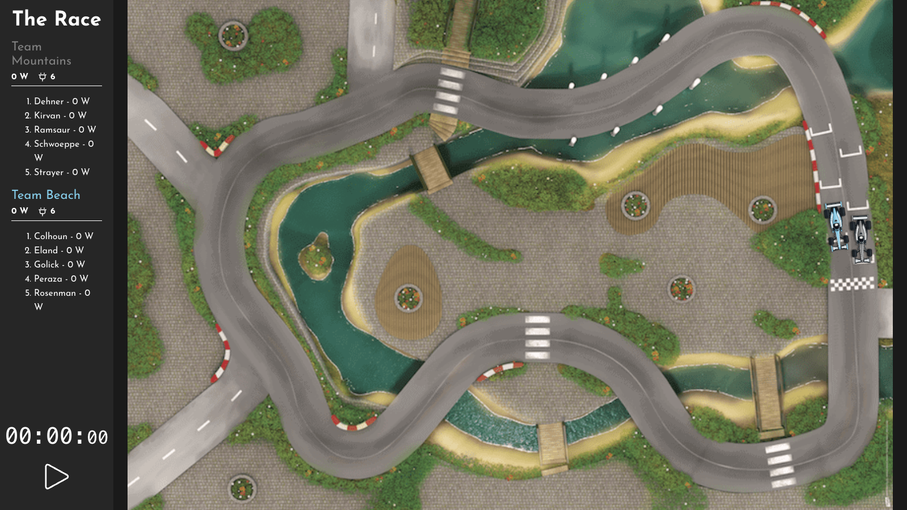
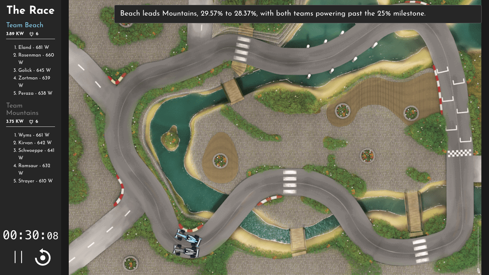
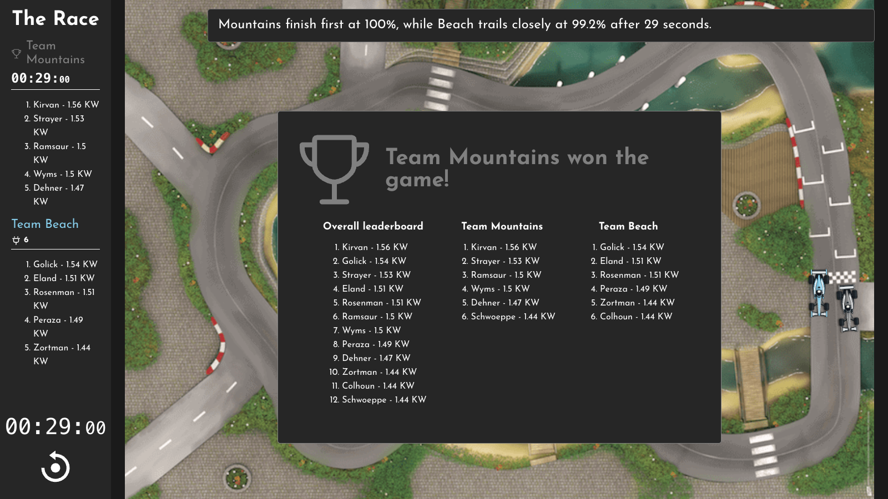
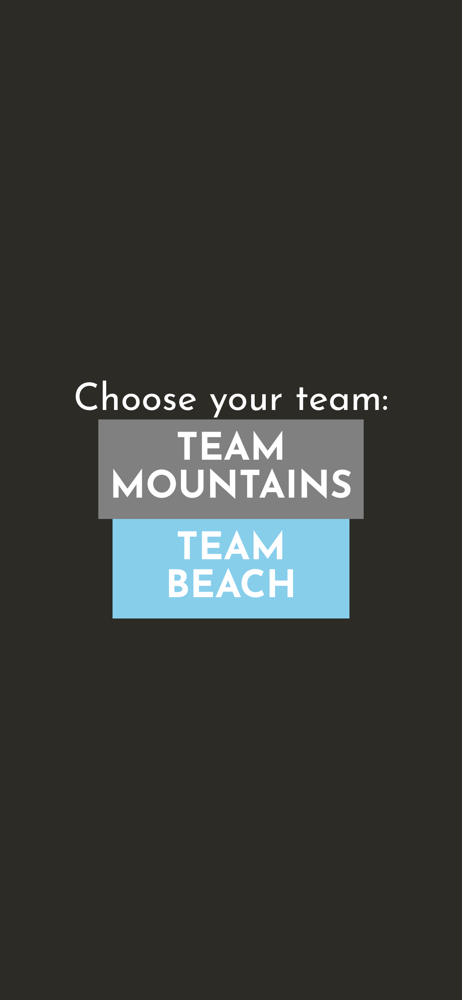
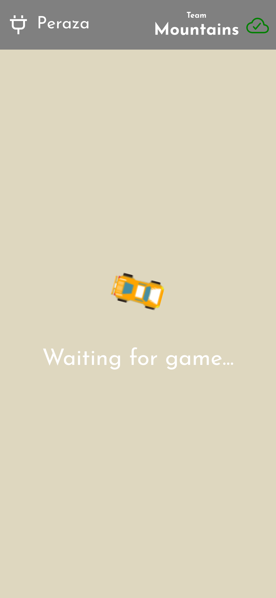
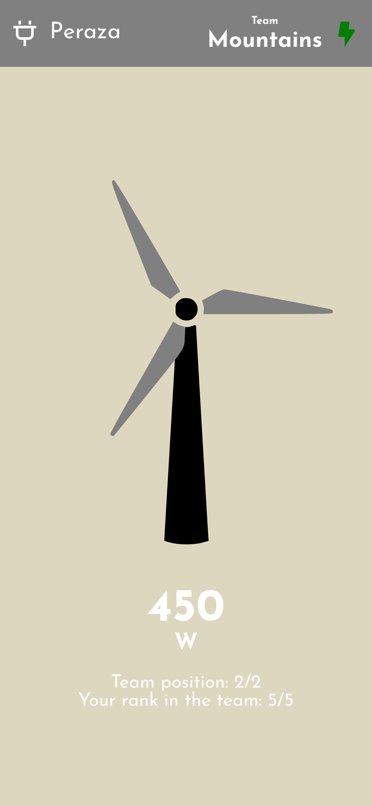
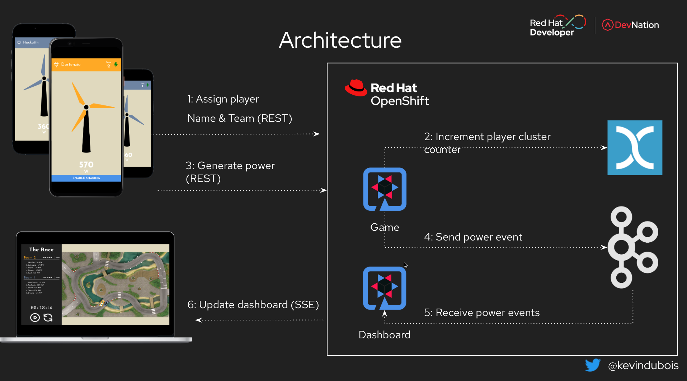
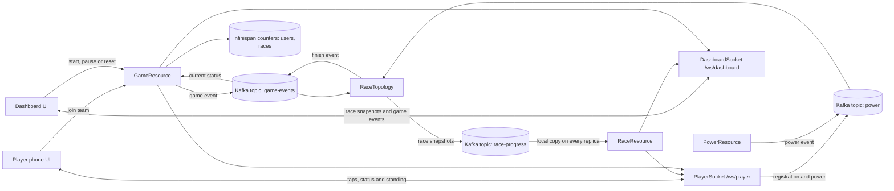

# Quinoa WindTurbine Racer Demo

This project uses Quarkus, the Supersonic Subatomic Java Framework.

The application is a small race game. Players join one of two teams, charge their turbines and send power during the race. The dashboard shows the race as it happens and the winning team at the end.

## The game

Before the race starts, players join and wait for the race to begin.



During the race, both teams generate power and the cars move across the track.



At the end of the race, the dashboard shows the winner.



### Player view

On their phone, players first choose a team.



After joining, they wait for the game to start.



When the race is running, they generate "power" from the mobile screen by either tapping, shaking, blowing or swiping.



## Architecture



The application has two browser entry points. The player screen is used on the phone, and the dashboard is used by the game operator. Both talk to the Quarkus backend. Power and game events go through Kafka, a Kafka Streams topology computes the race from them, and Infinispan holds the counters for player and race IDs.



A player joins through the main UI at the root of the domain and receives a generated name and team from `POST /api/game/assign`. The phone then opens a WebSocket to `/ws/player/{id}?team={team}`, and opening it registers the player with an empty event on the Kafka `power` topic. During the race, the phone adds up its taps and sends them over the socket at most every 200 ms, and the server publishes each batch to the same topic. Each power event is stamped with the current race ID, so power sent for a race that has since been reset doesn't count. `POST /api/power` still accepts one power event per request, which is what `GameLoader` uses by default.

Over the same socket, the phone receives the game status, its team's position, its own rank inside the team, and short notifications such as "Your team took the lead!". The server sends these from its local copy of the race, so the phone doesn't poll.

The race runs on the server. [`RaceTopology`](src/main/java/org/acme/RaceTopology.java) reads the `power` and `game-events` topics and keeps per-player scores and per-team totals in Kafka Streams state stores. It computes each team's distance, records the finish time when a team crosses the line, and writes the `finish` event once every team with players has finished. All race messages use the same key and partition, so one Streams task owns the race and only that task can decide the finish, even with several replicas.

The topology writes a snapshot of the race to the compacted `race-progress` topic at most every 250 ms, and only when the race changed. Every replica reads that topic from the start and keeps the latest snapshot, so any replica can answer race queries without calling the others. Because the dashboard only renders these snapshots, you can close the dashboard tab during a race, open it again, and the race continues from the same position.

The backend exposes the race over REST:

- `GET /api/race/state` returns the current race: status, race time, teams in race order and players sorted by power.
- `GET /api/race/leaderboard` returns the players with their rank. Add `?team=2` for one team.
- `GET /api/race/stream` is a server-sent events stream of the same snapshots.

The dashboard renders the race from the `/ws/dashboard` WebSocket, which sends the current race when it connects and then every snapshot and game event. It needs the dashboard login, and it only accepts connections from pages served by the app itself, because browsers send the login cookie with WebSocket handshakes from any site.

The operator starts, pauses and resets the race from the dashboard, which posts a game event to `/api/game/event`. A reset creates a new race ID and clears the players. Each replica then registers the players connected to it again, so they show up in the new race without tapping.

### Race commentary

The dashboard displays commentary for lead changes, each team's 25/50/75% milestones, player
surges and the finish. Template lines work by default. A shared Kafka consumer group generates
commentary once per race update, and the `race-commentary` topic distributes the lines to every
dashboard replica. Delivery is at-least-once, and dashboards discard duplicate event IDs.

Enable AI commentary with `GAME_AI_ENABLED=true` and `OPENAI_API_KEY`. The default model is
[`gpt-6-luna`](https://developers.openai.com/api/docs/models/gpt-6-luna), and `OPENAI_MODEL` selects
another model. In dev mode:

```bash
export OPENAI_API_KEY='<your API key>'
GAME_AI_ENABLED=true ./mvnw quarkus:dev
```

To use a local server that supports OpenAI Chat Completions, set its API base URL and model name:

```bash
GAME_AI_ENABLED=true OPENAI_BASE_URL=http://localhost:11434/v1/ \
  OPENAI_MODEL=granite4 OPENAI_API_KEY=unused OPENAI_REASONING_EFFORT= \
  ./mvnw quarkus:dev
```

Start the local model server and make the chosen model available first. The app doesn't download
models. An empty `OPENAI_REASONING_EFFORT` omits that optional parameter for servers that don't
support it. The hosted default uses `none` for short commentary.

The model receives only the event, team totals and the relevant player's generated name and
score. Each request has a two-second deadline. Provider errors and blank or overlong output use
the matching template, and only one request runs at a time. `GET /api/features` returns
`{"aiEnabled":false}` or `{"aiEnabled":true}` to report the configured mode.

`game.commentary.interval` (default `3s`) limits routine commentary. Finish bypasses that delay.
`game.commentary.timeout` (default `2s`) and `game.commentary.max-length` (default `180`) control
the request deadline and line length. A surge requires two windows of running race time, each
`game.commentary.surge-window` (default `5s`), and an increase at least
`game.commentary.surge-multiplier` (default `2`) times the previous window and
`game.commentary.surge-min-taps` (default `10`) taps' worth of power.

AI mode, endpoint and model changes take effect on restart. Without AI enabled, no model service
or credential is needed and template commentary stays visible.

## Running the application in dev mode

Install first:

- JDK 25

You can run your application in dev mode that enables live coding using:

```bash
./mvnw quarkus:dev
```

The default game needs Kafka and Infinispan, which Dev Services starts locally. Keycloak and
OpenAI are optional and disabled by default. Players, dashboard login and race controls,
read-only MCP and template commentary work without either service or any model credentials.

Keep `src/main/webui/package-lock.json` in Git so local builds and CI install the same frontend
dependencies. Generated directories such as `node_modules`, `target` and `.quinoa`, local
environment files and machine-specific tool settings are ignored.

If you already have the Quarkus CLI installed, you can also use:

```bash
quarkus dev
```

The application is available on `http://localhost:8080`.

The dashboard is available on `http://localhost:8080/dashboard`. In dev mode, log in with `developer` / `developer`.

### Dashboard login

The dashboard has one admin user, set with `game.admin.username` and `game.admin.password`, or with the `GAME_ADMIN_USERNAME` and `GAME_ADMIN_PASSWORD` environment variables. The username defaults to `developer`, and in dev and test mode the password is `developer`.

Outside dev and test, if no password is set, the app checks the login against `game.admin.password-digest`, a SHA-1 of `username:Quarkus:password`. The default digest is the existing workshop password, so deployments from the software template keep the login they already had. Setting a password replaces the digest:

```bash
GAME_ADMIN_USERNAME=admin GAME_ADMIN_PASSWORD=change-me java -jar target/quarkus-app/quarkus-run.jar
```

The digest includes the username, so if you change only the username, also set a password or a new digest. To compute one, run `printf 'admin:Quarkus:change-me' | shasum`.

## Testing the game in dev mode

The project includes a small load script in [`scripts/GameLoader.java`](scripts/GameLoader.java:34). It assigns players, waits for the game to start and then sends power events to the backend. This is useful when you want to exercise the game locally without using real phones or browsers for every player.

The script is written as a jbang script. If you have jbang installed, start the application in dev mode first and then run:

```bash
jbang scripts/GameLoader.java http://localhost:8080
```

By default the script creates 50 players. Each click sends a random 1..power, so `--clicks` is a
safety cap: over WebSockets the loader keeps tapping until the race finishes.

You can change the number of players, the click cap and the power value:

```bash
jbang scripts/GameLoader.java http://localhost:8080 --players 20 --power 15
```

With `--ws`, each simulated player opens the player WebSocket and sends its clicks as messages, the way the phones do, instead of one `POST /api/power` per click, and stops when the race finishes:

```bash
jbang scripts/GameLoader.java http://localhost:8080 --players 20 --power 15 --ws
```

To compare the two transports, run the script once in each mode and look at `http_server_requests_seconds` and the `quarkus_websockets_server_*` metrics on `http://localhost:8080/metrics`.

Open the dashboard while the script is running and hit the start button in the bottom left:

```text
http://localhost:8080/dashboard
```

## Controlling the race from an MCP client

The app is also an MCP server, so an agent such as Claude Code or goose can read the race and, with an admin login, run it. There are two endpoints, because MCP clients only start their login when the server answers with a 401.

`/mcp` needs no login. It has the tools `get_race_state`, `get_leaderboard` and `get_player`, and the resource `race://current`, which sends an update notification to subscribers every time the race changes.

`/admin/mcp` has the same tools and resource, plus `start_race`, `pause_race` and `reset_race`. It
needs a bearer token with the `admin` role from the `wind-turbine` Keycloak realm. Enable OIDC
explicitly to use it. For local development:

```bash
GAME_OIDC_ENABLED=true ./mvnw quarkus:dev
```

Keycloak Dev Services then imports [`wind-turbine-realm.json`](src/main/resources/keycloak/wind-turbine-realm.json),
with the user `developer` / `developer`. With OIDC enabled, a request without a token gets a 401
that points to `/.well-known/oauth-protected-resource/admin/mcp`, where the client finds the realm
and runs the login in a browser. With OIDC disabled, admin MCP rejects every request with 403,
including requests with a dashboard login cookie.
The dashboard uses its separate form login and keeps working in either mode.

The project's [`.mcp.json`](.mcp.json) lists both endpoints as `wind-turbine-race` and `wind-turbine-admin`, next to the Quarkus Agent MCP, so Claude Code offers them when you open the repository and asks you to approve them once. They only connect while dev mode runs. The admin entry uses the realm's public client `mcp-agent`, whose redirect URI is `http://localhost:33418/callback`, so keep its callback port if you add the server to another client. For another URL, such as a deployment on OpenShift, add a server yourself with the same client:

```bash
claude mcp add --transport http --client-id mcp-agent --callback-port 33418 wind-turbine-admin https://<your route>/admin/mcp
```

To log in, run `/mcp` in Claude Code, pick `wind-turbine-admin`, choose Authenticate and log in as `developer`. You can then ask it, for example, to start the race and tell you when one team passes 50%.

With the project's URL-only [`.bob/mcp.json`](.bob/mcp.json), Bob uses OAuth dynamic client registration instead of `mcp-agent`. The dev realm accepts anonymous registration and applies the `wind-turbine-audience` client scope to new clients. Keycloak asks the operator to consent during browser login. Dev Services uses port 8181 so its authorization server URL stays the same across restarts. Restart dev mode after changing the realm file so Keycloak imports the new policy; an already running container keeps its old realm configuration.

If Bob returns to `Needs auth` after browser login and Quarkus logs `The JWT is no longer valid`, compare `date -u` with `podman machine ssh date -u`. A Podman VM clock behind the host makes new Keycloak tokens appear expired to Quarkus. Run `podman machine ssh sudo chronyc -a burst 4/4`, check the clocks again, then use `Reset auth` and `Authenticate` in Bob.

OIDC is off by default in every mode. Outside dev and test, enabling it also needs
`GAME_OIDC_URL` pointing at the realm, for example `https://keycloak.example.com/realms/wind-turbine`.
Tests that exercise token authentication enable OIDC in their own test profile.

## Customizing the game

Team names, colors and car images are set in
[`application.properties`](src/main/resources/application.properties). The dashboard, player screen
and commentary all use these settings:

```properties
game.teams.1.name=Mountains
game.teams.1.color=grey
game.teams.1.car=car-orange
game.teams.2.name=Beach
game.teams.2.color=skyblue
game.teams.2.car=car-blue-convertible
```

The UI loads the team configuration from `GET /api/config` before rendering. Change the properties
and restart the app, then reload open pages. The available car images are listed in
[`Config.js`](src/main/webui/src/Config.js), which still exports `TEAMS_CONFIG` for the components.

The race rules are set on the server in `application.properties`. `game.tap-power` is the power of one tap and `game.taps-needed-per-player` is how many taps each player needs for their team to finish. A team's distance is its power × 100 / (tap power × taps needed × players in the team). `TAP_POWER` in `Config.js` sets the power each tap sends from the phone, so keep it equal to `game.tap-power`. `SHOW_TOP` sets how many players the dashboard shows per team.

The player controls are enabled in the same file with [`ENABLE_TAPPING`](src/main/webui/src/Config.js:27), [`ENABLE_SHAKING`](src/main/webui/src/Config.js:28), [`ENABLE_BLOWING`](src/main/webui/src/Config.js:29) and [`ENABLE_SWIPING`](src/main/webui/src/Config.js:30). This lets you switch between the different interaction modes used by the game.

When the application is running in dev mode, changes in [`src/main/webui/src/Config.js`](src/main/webui/src/Config.js:1) are picked up automatically.

## Running with a container image

Build the application first:

```bash
./mvnw package
```

Then build the container image:

```bash
docker build -f src/main/docker/Dockerfile.jvm -t quarkus/quinoa-wind-turbine-jvm .
```

Run the image with:

```bash
docker run -i --rm -p 8080:8080 quarkus/quinoa-wind-turbine-jvm
```

## Deploy on OpenShift

The game runs against either Strimzi (Kafka on the cluster) or Confluent Cloud, chosen by the
`openshift-cluster` or `confluent` profile. Both use the same image and JSON messages, so switching
providers only changes configuration.

[OpenShift installation](docs/openshift-install.md) has the full setup: the operators, the generated
secrets, Infinispan, Kafka, the optional Keycloak for admin MCP, the app deploy and a race to verify
it. [GitOps and pipeline setup](docs/gitops-pipeline.md) covers the optional GitOps and Tekton flow.

The short version, once the operators, secrets, Infinispan and Kafka from that guide are in place:

```bash
# Build the image in CI and deploy it (the GitHub Action pushes to ghcr.io on main):
oc new-app --image=ghcr.io/<owner>/quinoa-wind-turbine:latest --name=quinoa-wind-turbine

# Or build from source on the cluster, pushing to the internal registry:
./mvnw clean package -Dquarkus.profile=openshift-cluster -Dquarkus.kubernetes.deploy=true -DskipTests \
  -Dquarkus.container-image.registry=image-registry.openshift-image-registry.svc:5000 \
  -Dquarkus.container-image.group=$(oc project -q)
```

Use `-Dquarkus.profile=confluent` instead for a Confluent Cloud deployment. The profile sets the
Java 25 base image, five replicas, resource limits and the probes. Delete the app with:

```bash
oc delete all -l app.kubernetes.io/name=quinoa-wind-turbine
```
