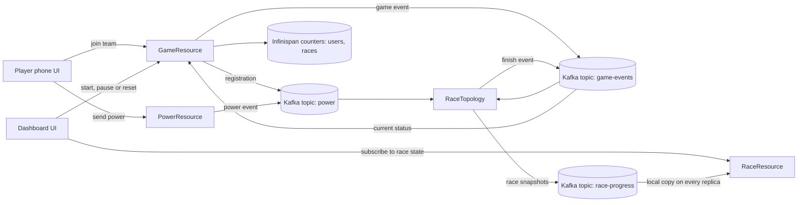

# Quinoa WindTurbine Racer Demo

This project uses Quarkus, the Supersonic Subatomic Java Framework.

The application is a small race game. Players join one of two teams, charge their turbines and send power during the race. The dashboard shows the race as it happens and the winning team at the end.

## The game

Before the race starts, players join and wait for the race to begin.


During the race, both teams generate power and the cars move across the track.


At the end of the race, the dashboard shows the winner.


### Player view

On their phone, players first choose a team.


After joining, they wait for the game to start.


When the race is running, they generate "power" from the mobile screen by either tapping, shaking, blowing or swiping.


## Architecture


The application has two browser entry points. The player screen is used on the phone, and the dashboard is used by the game operator. Both talk to the Quarkus backend. Power and game events go through Kafka, a Kafka Streams topology computes the race from them, and Infinispan holds the counters for player and race IDs.



A player joins through the main UI at the root of the domain, receives a generated name and team, and an initial event is written to the Kafka `power` topic. During the race, the phone sends power updates to `/api/power`, which publishes them to the same topic. Each power event is stamped with the current race ID, so power sent for a race that has since been reset doesn't count.

The race runs on the server. [`RaceTopology`](src/main/java/org/acme/RaceTopology.java) reads the `power` and `game-events` topics and keeps per-player scores and per-team totals in Kafka Streams state stores. It computes each team's distance, records the finish time when a team crosses the line, and writes the `finish` event once every team with players has finished. All race messages use the same key and partition, so one Streams task owns the race and only that task can decide the finish, even with several replicas.

The topology writes a snapshot of the race to the compacted `race-progress` topic at most every 250 ms, and only when the race changed. Every replica reads that topic from the start and keeps the latest snapshot, so any replica can answer race queries without calling the others. Because the dashboard only renders these snapshots, you can close the dashboard tab during a race, open it again, and the race continues from the same position.

The backend exposes the race over REST:

- `GET /api/race/state` returns the current race: status, race time, teams in race order and players sorted by power.
- `GET /api/race/leaderboard` returns the players with their rank. Add `?team=2` for one team.
- `GET /api/race/stream` is the server-sent events stream the dashboard uses.

The operator starts, pauses and resets the race from the dashboard, which posts a game event to `/api/game/event`. A reset creates a new race ID and clears the players, and phones register again within a few seconds because they send an empty power event every 3 seconds.

## Running the application in dev mode

Install first:

- JDK 25

You can run your application in dev mode that enables live coding using:

```bash
./mvnw quarkus:dev
```

If you already have the Quarkus CLI installed, you can also use:

```bash
quarkus dev
```

The application is available on `http://localhost:8080`.

The dashboard is available on `http://localhost:8080/dashboard`. In dev mode, log in with `developer` / `developer`.

### Dashboard login

The dashboard has one admin user, set with `game.admin.username` and `game.admin.password`, or with the `GAME_ADMIN_USERNAME` and `GAME_ADMIN_PASSWORD` environment variables. The username defaults to `developer`, and in dev and test mode the password is `developer`.

Outside dev and test, if no password is set, the app checks the login against `game.admin.password-digest`, a SHA-1 of `username:Quarkus:password`. The default digest is the existing workshop password, so deployments from the software template keep the login they already had. Setting a password replaces the digest:

```bash
GAME_ADMIN_USERNAME=admin GAME_ADMIN_PASSWORD=change-me java -jar target/quarkus-app/quarkus-run.jar
```

The digest includes the username, so if you change only the username, also set a password or a new digest. To compute one, run `printf 'admin:Quarkus:change-me' | shasum`.

## Testing the game in dev mode

The project includes a small load script in [`scripts/GameLoader.java`](scripts/GameLoader.java:34). It assigns players, waits for the game to start and then sends power events to the backend. This is useful when you want to exercise the game locally without using real phones or browsers for every player.

The script is written as a jbang script. If you have jbang installed, start the application in dev mode first and then run:

```bash
jbang scripts/GameLoader.java http://localhost:8080
```

By default the script creates 50 players and sends 100 power events for each player.

You can change the number of players, the number of clicks and the power value:

```bash
jbang scripts/GameLoader.java http://localhost:8080 --players 20 --clicks 50 --power 15
```

Open the dashboard while the script is running and hit the start button in the bottom left:

```text
http://localhost:8080/dashboard
```

## Customizing the game

The main game settings are in [`src/main/webui/src/Config.js`](src/main/webui/src/Config.js:1).

Team names, colors and car images are defined in [`TEAMS_CONFIG`](src/main/webui/src/Config.js:8). Update the `name`, `color` and `car` fields for each team to change how the game looks on the dashboard and on the player screen.

The available car image names are listed in the comment above [`TEAMS_CONFIG`](src/main/webui/src/Config.js:7).

The race rules are set on the server in `application.properties`. `game.tap-power` is the power of one tap and `game.taps-needed-per-player` is how many taps each player needs for their team to finish. A team's distance is its power × 100 / (tap power × taps needed × players in the team). [`TAP_POWER`](src/main/webui/src/Config.js:22) in `Config.js` sets the power each tap sends from the phone, so keep it equal to `game.tap-power`. [`SHOW_TOP`](src/main/webui/src/Config.js:24) sets how many players the dashboard shows per team.

The player controls are enabled in the same file with [`ENABLE_TAPPING`](src/main/webui/src/Config.js:27), [`ENABLE_SHAKING`](src/main/webui/src/Config.js:28), [`ENABLE_BLOWING`](src/main/webui/src/Config.js:29) and [`ENABLE_SWIPING`](src/main/webui/src/Config.js:30). This lets you switch between the different interaction modes used by the game.

When the application is running in dev mode, changes in [`src/main/webui/src/Config.js`](src/main/webui/src/Config.js:1) are picked up automatically.

## Running with a container image

Build the application first:

```bash
./mvnw package
```

Then build the container image:

```bash
docker build -f src/main/docker/Dockerfile.jvm -t quarkus/quinoa-wind-turbine-jvm .
```

Run the image with:

```bash
docker run -i --rm -p 8080:8080 quarkus/quinoa-wind-turbine-jvm
```

## Deploy on OpenShift

There are two ways to deploy this demo on OpenShift.

If you want to deploy the application directly from Quarkus, see the section below.

If you want the full demo setup with GitOps, pipelines, Kafka and Infinispan, see [OpenShift installation](docs/openshift-install.md) and [GitOps and pipeline setup](docs/gitops-pipeline.md).

## When deploying from Quarkus

### Copy sandbox OpenShift resource file

```bash
cp src/main/kubernetes/openshift.cluster.yml src/main/kubernetes/openshift.yml
```

### Deploy

```bash
quarkus build -Dquarkus.kubernetes.deploy=true -Dquarkus.profile=openshift-cluster -Dquarkus.container-image.group=[project name]
```

### Update

```bash
quarkus build -Dquarkus.container-image.build=true -Dquarkus.profile=openshift-cluster -Dquarkus.container-image.group=[project name]
```

### Delete deployed app

```bash
oc delete all -l app.kubernetes.io/name=quinoa-wind-turbine
