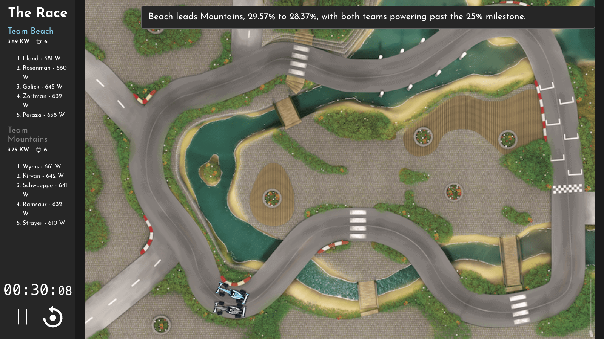
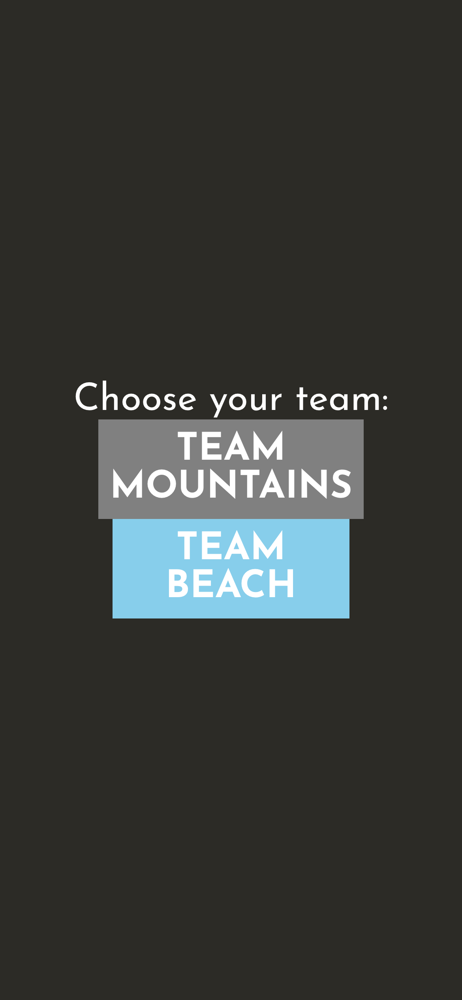
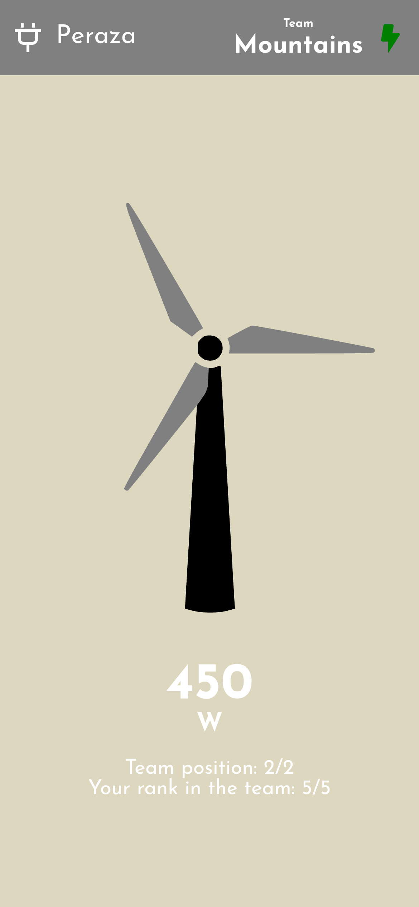
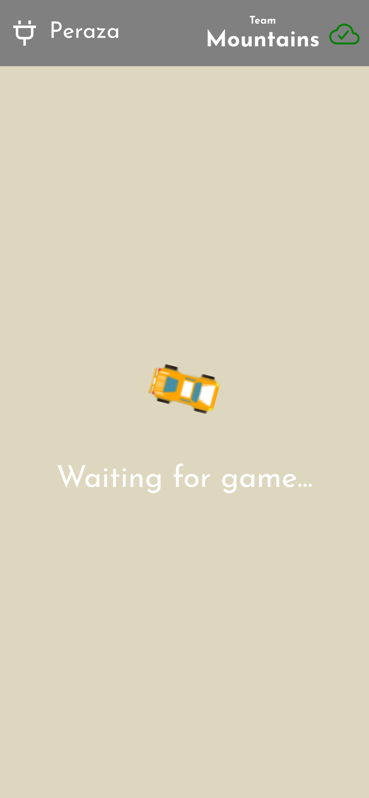
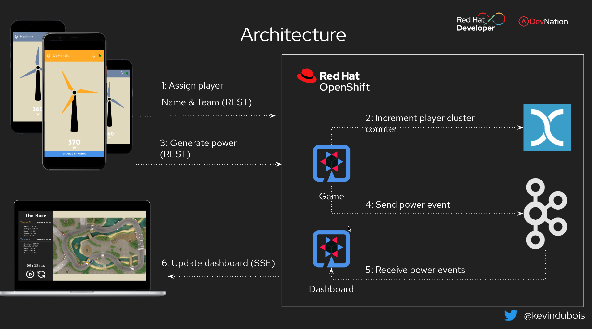

# Quinoa WindTurbine Racer

A multiplayer race game built with Quarkus and React. Players join one of two teams on their phone and generate power by tapping, shaking, blowing or swiping. The dashboard shows the cars racing in real time, and the team with the most power crosses the line first.



| Choose a team | Generate power | Wait for the start |
|---|---|---|
|  |  |  |

A race goes through four steps:

1. Players open the app on their phone and pick a team.
2. The operator presses play on the dashboard.
3. Both teams generate power and their cars move along the track.
4. The winner shows on the dashboard and is saved to the hall of fame.

## Run it locally

You need JDK 25, [jbang](https://www.jbang.dev/) and Podman or Docker, because Dev Services
starts Kafka and Infinispan for you.

```bash
jbang scripts/DevMode.java start
```

That starts the whole local mesh, in the order the services need: the game with Keycloak on
:8080, the analyst on :8082, the creative director on :8083, and the race director on :8081.
Pick a smaller mode when you don't need the agents:

| Mode | What runs |
|---|---|
| `mesh` (default) | game, director, both specialists |
| `ops` | game and director, no specialists |
| `oidc` | game only, with Keycloak and the admin MCP tools |
| `bare` | game only, no Keycloak |

```bash
jbang scripts/DevMode.java start ops --players 8   # 8 simulated players join the next race
jbang scripts/DevMode.java status
jbang scripts/DevMode.java logs ops
jbang scripts/DevMode.java stop
```

Every start waits for the endpoint that only answers when that service is ready. The modes with
OIDC then check that `/admin/mcp` answers 401, which is how they know Keycloak came up. Logs land
in `target/dev-mode/`.

`stop` also shuts down a dev mode you started yourself on one of those ports, and waits for the
game to release port 8080 (about ten seconds), so you can start again straight away.

| | URL |
|---|---|
| Player screen | http://localhost:8080 |
| Dashboard | http://localhost:8080/dashboard (log in as `developer` / `developer`) |
| Director console | http://localhost:8081/ops.html |

Outside dev mode, set the dashboard login with `GAME_ADMIN_USERNAME` and `GAME_ADMIN_PASSWORD`.

## Try a race

Open the dashboard and the player screen in a few browser tabs or on phones on the same network, then press play on the dashboard.

To fill the race without phones, start simulated players with [jbang](https://www.jbang.dev/):

```bash
jbang scripts/GameLoader.java http://localhost:8080 --players 20 --power 10 --interval 75 --ws
```

`--power` is the most power a tap can add, and `--interval` is the number of milliseconds between taps. With these values a race takes about 20 seconds.

You can also ask your code assistant to run the race. After the one-time setup in [Use MCP and code assistants](#use-mcp-and-code-assistants), try:

> Reset the race, add 12 simulated players, start it and tell me when one team passes 50%.

## Deploy on OpenShift

You need OpenShift 4.14 or later and `oc` logged in as a cluster admin.

The supported deployment is the GitOps tree in [`deploy/`](deploy/): an Argo CD pointer applies
`deploy/overlays/openshift-cluster` and reconciles the Keycloak realm, and the images come from
`ghcr.io/redhat-developer-demos`. The script below is the fallback for a from-scratch s2i install on a
cluster without that setup.

```bash
scripts/deploy-openshift.sh
```

The script installs the Kafka and Infinispan operators, creates the secrets, deploys Infinispan and Kafka and builds the app on the cluster. If a Keycloak already runs on the cluster, it also imports the `wind-turbine` realm for the admin MCP tools. It is safe to re-run, and it reuses existing passwords.

```bash
# Use another namespace, and skip the realm import (no admin MCP tools)
NAMESPACE=my-game SKIP_KEYCLOAK=1 scripts/deploy-openshift.sh
```

A Keycloak in another namespace or with another name is set with `KEYCLOAK_NAMESPACE` and `KEYCLOAK_CR`. The guide below shows how to install a fresh one.

Find the app URL and the dashboard password once it finishes:

```bash
oc get route quinoa-wind-turbine -o jsonpath='https://{.spec.host}{"\n"}'
oc get secret game-admin -o jsonpath='{.data.password}' | base64 -d
```

Log in to `/dashboard` as `developer` with that password. Then run the GameLoader against the route:

```bash
jbang scripts/GameLoader.java https://<route> --players 20 --power 10 --interval 75 --ws
```

For Confluent Cloud, manual steps, GitOps and the Tekton pipeline, see the [OpenShift installation guide](docs/openshift-install.md) and the [GitOps and pipeline setup](docs/gitops-pipeline.md).

## Customize the game

Team names, colors and cars are set in [`application.properties`](src/main/resources/application.properties). Restart the app and reload open pages to see a change.

```properties
game.teams.1.name=Mountains
game.teams.1.color=grey
game.teams.1.car=car-orange
game.teams.2.name=Beach
game.teams.2.color=skyblue
game.teams.2.car=car-blue-convertible
```

The available car images are listed in [`Config.js`](src/main/webui/src/Config.js).

To restyle the race without a restart, apply a theme between races. A theme sets the team names, colors, cars and track on every dashboard and phone at once. A finished heat stays on the board until it is reset, so applying a theme then resets that heat first: the new names never land on the leaderboard of the race that just ended. Ask your assistant:

> List the preset themes and apply one.

An admin can also restyle from the dashboard's theme panel (presets, team names and colors), or send a full theme with `POST /api/theme`. With `game.ai.enabled=true`, two more endpoints use a model: `POST /api/theme/suggest-names` localizes the team names for an event or location onto the current colors, and `POST /api/theme/generate` returns and applies a full theme. A generated theme is validated first, so a bad answer keeps the current look. An MCP client gets the same two paths as the `suggest_team_names` and `generate_theme` tools.

The race length is set on the server:

```properties
game.tap-power=15
game.taps-needed-per-player=100
```

A team finishes when its power reaches `tap power × taps needed × players in the team`. Keep `TAP_POWER` in [`Config.js`](src/main/webui/src/Config.js) equal to `game.tap-power`.

### Player input mode

Players drive the windmill by tapping, shaking the phone, or both. The mode is a server setting, `game.input.mode` (`tap`, `shake` or `both`, default `tap`), used until the first switch. An agent with the admin MCP server switches it between races with the `set_input_mode` tool. Like a theme, a switch is rejected while a race is running or paused. Every dashboard and phone follows the change without a reload, and the "Race Started!" text on the dashboard changes with it. `GET /api/config` returns the current `inputMode`.

The active mode is stored in Infinispan, so it is the same on every replica. It survives an app restart as long as the Infinispan server keeps its data; dev mode starts a fresh Infinispan container on each start, so the mode returns to the `game.input.mode` default there. A phone that was offline when the mode changed reads it again when its socket reconnects.

When the mode includes shaking, each phone shows the **Enable Shaking** overlay and keeps it until the player taps it, because iOS only grants motion access after a tap. A phone that already enabled shaking skips it. A device without motion sensors (no `DeviceMotionEvent`) can't shake, so tapping works in every mode there and the overlay isn't shown.

`Config.js` still holds the `ENABLE_BLOWING` and `ENABLE_SWIPING` flags (both off) and sets how many players the dashboard shows per team (`SHOW_TOP`).

### AI commentary

The dashboard shows template commentary for lead changes, milestones and the finish. To let a model write the lines instead:

```bash
export OPENAI_API_KEY='<your API key>'
GAME_AI_ENABLED=true ./mvnw quarkus:dev
```

For a local model server that speaks the OpenAI API:

```bash
GAME_AI_ENABLED=true OPENAI_BASE_URL=http://localhost:11434/v1/ \
  OPENAI_MODEL=granite4 OPENAI_API_KEY=unused OPENAI_REASONING_EFFORT= \
  ./mvnw quarkus:dev
```

On errors or slow answers the game falls back to the template line. The other commentary settings are in [How it works](docs/architecture.md#race-commentary).

The commentator's voice is a prompt fragment, not a separate model. `game.commentary.style` sets the default (`broadcast`, `hype`, `analyst` or `dry`), and an agent with the admin MCP server switches it between races with `set_commentary_style`. Every replica switches on the next line, and `GET /api/config` returns the active `commentaryStyle`.

## Use MCP and code assistants

The app is an MCP server, so an agent such as IBM Bob, Claude Code, Codex or goose, etc can read the race and run it.

| Server | URL | Login | Tools |
|---|---|---|---|
| `wind-turbine-race` | `/mcp` | none | `get_race_state`, `get_leaderboard`, `get_player`, `get_hall_of_fame` |
| `wind-turbine-admin` | `/admin/mcp` | `developer` / `developer` | the same, plus `start_race`, `pause_race`, `reset_race`, `boost_team`, `reset_hall_of_fame`, `list_preset_themes`, `apply_theme`, `set_input_mode`, `set_commentary_style`, and, with AI on, `suggest_team_names` and `generate_theme` |

Both servers also expose prompts, the MCP template primitive. `/mcp` has `race_briefing` (the live standings plus the rules, for a chosen commentary style and focus) and `race_recap` (a finished heat from the hall of fame). `/admin/mcp` adds `theme_idea`, a design brief with the presets, allowed cars and validation rules for the next heat. A client lists them with `prompts/list` and asks for one with `prompts/get`; the arguments come back filled in, so the model never has to know the JSON shape.

Both are listed in [`.mcp.json`](.mcp.json) (and [`.bob/mcp.json`](.bob/mcp.json) for Bob). Claude Code offers them when you open the repository.

To use the admin tools in dev mode, start with OIDC on, which the local script does:

```bash
jbang scripts/DevMode.java start        # the whole mesh, admin MCP included
jbang scripts/DevMode.java start oidc   # the game alone, admin MCP included
```

OIDC is the `quarkus.oidc.tenant-enabled` property, so a plain dev mode start does the same job
with `GAME_OIDC_ENABLED=true ./mvnw quarkus:dev`. That is also the form a code assistant passes
through the Quarkus Agent MCP, whose `quarkus_start` takes extra command-line arguments but no
environment variables:

```bash
./mvnw quarkus:dev -Dquarkus.oidc.tenant-enabled=true
```

In your code assistant, run `/mcp`, pick `wind-turbine-admin` (or `wind-turbine-admin-cluster`), choose Authenticate and log in as `developer`. Only you can do this step, because it opens a browser.


The repository also has two skills in [`.agents/skills`](.agents/skills):

| Skill | What it does |
|---|---|
| `wind-turbine-mcp-demo` | Resets the race, adds simulated players, starts it and reports lead changes and milestones through the MCP tools |
| `wind-turbine-load-test` | Runs the GameLoader against the app and reads the Prometheus metrics |

Things to ask:

> Start the race and tell me when one team passes 50%.

> Secretly boost team 2 by 1.5x for 20 seconds.

> Show the hall of fame.

Bob, OAuth dynamic client registration and troubleshooting are in [MCP and code assistants](docs/mcp.md).

## How it works



Phones and the dashboard connect to the Quarkus backend over WebSockets. Power and game events go through Kafka, and a Kafka Streams topology ([`RaceTopology`](src/main/java/org/acme/race/RaceTopology.java)) computes the race. Every replica keeps the latest race snapshot, and Infinispan holds the player counters and the hall of fame.

The REST API, WebSocket protocol, hall of fame, commentary and dashboard login are described in [How it works](docs/architecture.md).

Run the tests with:

```bash
./mvnw test             # unit and API tests
./mvnw test -Poptional  # AI commentary and cheat endpoint tests
./mvnw test -Pe2e       # browser tests (Playwright)
```

Project conventions and a package guide for contributors and agents are in [AGENTS.md](AGENTS.md).
