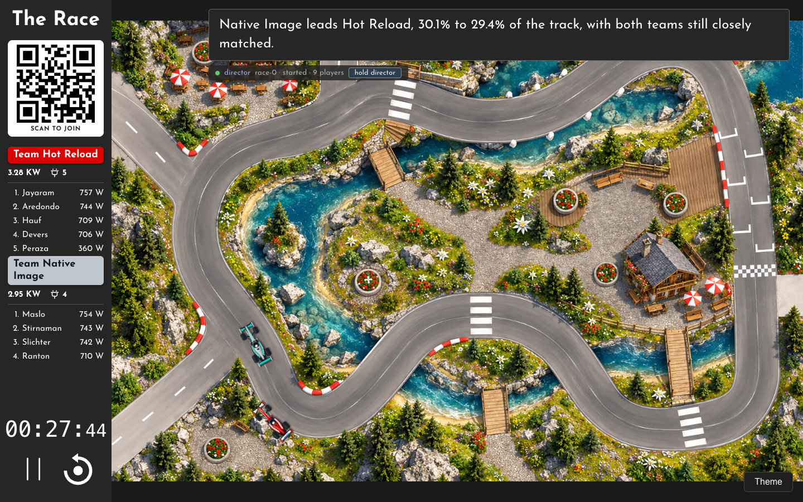
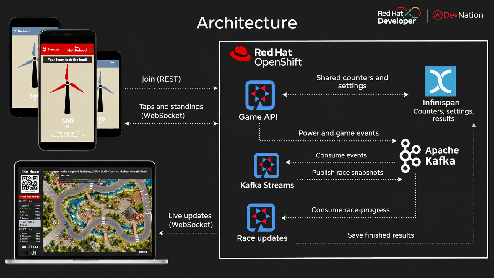
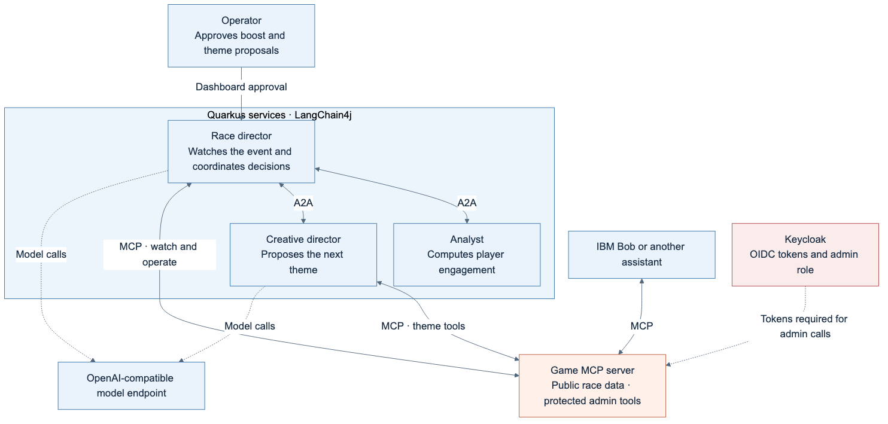
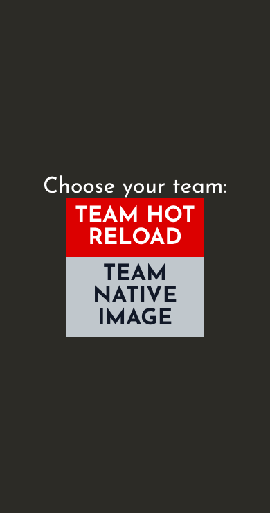
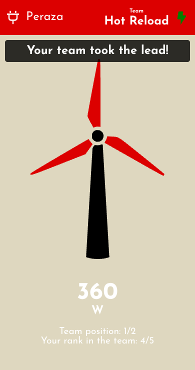

# Quinoa WindTurbine Racer

A Quarkus example combining Kafka, distributed caching, authentication and AI agents on Red Hat OpenShift. The interactive racing game puts these integrations to work. Players power cars from their phones, a dashboard follows the race, and agents collaborate to help run the event.



## Architecture

Quarkus serves the React UI through Quinoa and connects the browsers to the event-driven backend.

- Apache Kafka carries power and lifecycle events. Kafka Streams computes scores, positions and the finish order.
- Infinispan provides distributed counters and caches for player registration, input settings and finished results.
- WebSockets carry live taps and race updates. REST handles joining and dashboard controls.



### Agents and security

The game exposes a Model Context Protocol (MCP) server for assistants such as IBM Bob, Claude and Codex. A Quarkus LangChain4j director uses the same tools and consults specialist services over Agent2Agent (A2A).

- The analyst computes player engagement, and the creative director proposes themes for the next heat.
- The operator approves boost and theme proposals before they execute.
- Keycloak issues OpenID Connect tokens for administrative MCP tools. Public race tools allow anonymous reads, and the dashboard uses form login.
- Commentary and theme generation can use an OpenAI-compatible model endpoint.



Read more about [event flow and state](docs/architecture.md), [agent decisions](race-ops/README.md) or [connecting an MCP client](docs/mcp.md).

## Run it locally

You need JDK 25, [JBang](https://www.jbang.dev/) and a running Docker or Podman engine. From the repository root, start Quarkus dev mode.

```bash
jbang scripts/DevMode.java start
```

The launcher starts the game, director and both specialists in order. Dev Services provisions Kafka, Infinispan and Keycloak.

1. Open the [dashboard](http://localhost:8080/dashboard) and sign in with `developer` / `developer`.
2. Join from the [player screen](http://localhost:8080/), or [simulate players with GameLoader](#simulate-players).
3. Press play and tap the turbine. The [director console](http://localhost:8081/ops.html) shows observations and proposals.

The director can also start a heat automatically once both teams have enough players and the join count settles.

For phones on the same Wi-Fi, prefix the initial start command with `QUARKUS_HTTP_HOST=0.0.0.0`. Open the dashboard using your computer's LAN address so players can scan its QR code.

<p>
  
  
</p>

For the look shown here, select *Ferrari vs Mercedes* in the dashboard's *Theme* panel between heats, then rename the teams *Hot Reload* and *Native Image*.

### Model configuration

Set `OPENAI_BASE_URL`, `OPENAI_MODEL` and `OPENAI_API_KEY` before starting to use your own model endpoint. `GAME_AI_ENABLED=true` enables the game's AI commentary and theme tools. The [director](race-ops/README.md) and [creative service](race-creative/README.md) have their own model settings.

### Manage dev mode

```bash
jbang scripts/DevMode.java status
jbang scripts/DevMode.java stop
```

For a smaller setup, use `start oidc` for the game with Keycloak, or `start ops` for the game and director.

## Simulate players

[GameLoader](scripts/GameLoader.java) registers simulated players across both teams and sends taps over the same WebSocket endpoint as the phones. Run it against the local game or a remote deployment, using the application's base URL.

```bash
# Local dev mode
jbang scripts/GameLoader.java http://localhost:8080 --players 12 --power 10 --interval 200 --ws

# Remote deployment (replace the example URL with your route)
jbang scripts/GameLoader.java https://your-game.example.com --players 12 --power 10 --interval 200 --ws
```

Start the loader before a fresh heat, then press play on the dashboard or let the director start it. The loader waits for the start and stops when the race finishes.

- `--players` sets the number of simulated players.
- `--power` sets the maximum power per tap. Each tap uses a random value from 1 to that maximum.
- `--interval` sets milliseconds between tap batches. Lower values produce faster races.
- `--ws` uses WebSockets. Without it, the loader sends power through REST.

## Deploy on OpenShift

The maintained demo uses Argo CD and the [GitOps manifests](deploy/). Adapt the [OpenShift overlay](deploy/overlays/openshift-cluster/) for your routes, workload identities and secret integrations, and provision its referenced services.

For a fresh installation with on-cluster builds, use the deployment script. You need JDK 25, JBang and `oc` logged in as a cluster administrator. Configure Keycloak first to include authenticated MCP access and the agents. [Installation and Keycloak setup](docs/openshift-install.md)

```bash
scripts/deploy-openshift.sh
```

The script installs the Kafka and Infinispan operators, creates secrets and deploys the services into `wind-turbine`. Set `NAMESPACE`, `KEYCLOAK_NAMESPACE` and `KEYCLOAK_CR` to use different locations.

Retrieve the route and dashboard password after deployment.

```bash
oc get route quinoa-wind-turbine -n wind-turbine -o jsonpath='https://{.spec.host}{"\n"}'
oc get secret game-admin -n wind-turbine -o jsonpath='{.data.password}' | base64 -d
```

Sign in at `/dashboard` as `developer` with that password. Phones join at the route's root URL.

The cluster also demonstrates authentication with projected service-account tokens and [SPIFFE workload identities](docs/openshift-install.md#optional-workload-identity-with-spire).

## Development

Stop the relevant service's dev mode before running its tests.

```bash
./mvnw test                         # game unit and API tests
./mvnw -f race-ops/pom.xml test      # director tests
./mvnw test -Pe2e                   # browser tests
```

See the [project guide](AGENTS.md) for the source layout and development conventions, and the [analyst](race-analyst/README.md) and [creative director](race-creative/README.md) guides for the A2A services.
