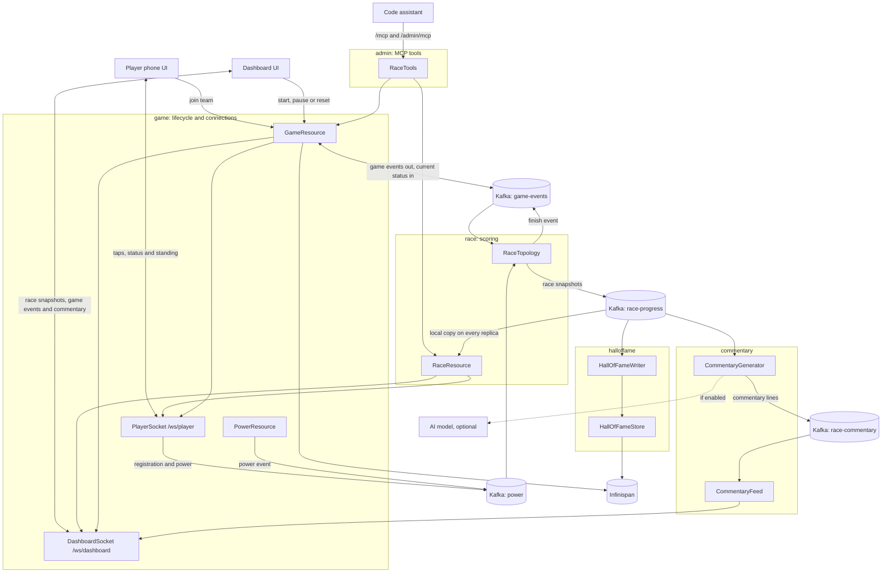

# How it works


The application has two browser entry points. The player screen is used on the phone, and the dashboard is used by the game operator. Both talk to the Quarkus backend. Power and game events go through Kafka, a Kafka Streams topology computes the race from them, and Infinispan holds the counters for player and race IDs.



The theme package (`ThemeService`) isn't drawn. It applies a theme by sending a `theme` game event, so it follows the same path as `GameResource`.

A player joins through the main UI at the root of the domain and receives a generated name and team from `POST /api/game/assign`. The phone then opens a WebSocket to `/ws/player/{id}?team={team}`, and opening it registers the player with an empty event on the Kafka `power` topic. During the race, the phone adds up its taps and sends them over the socket at most every 200 ms, and the server publishes each batch to the same topic. Each power event is stamped with the current race ID, so power sent for a race that has since been reset doesn't count. `POST /api/power` still accepts one power event per request, which is what `GameLoader` uses by default.

Over the same socket, the phone receives the game status, its team's position, its own rank inside the team, and short notifications such as "Your team took the lead!". The server sends these from its local copy of the race, so the phone doesn't poll.

The race runs on the server. [`RaceTopology`](../src/main/java/org/acme/race/RaceTopology.java) reads the `power` and `game-events` topics and keeps per-player scores and per-team totals in Kafka Streams state stores. It computes each team's distance, records the finish time when a team crosses the line, and writes the `finish` event once every team with players has finished. All race messages use the same key and partition, so one Streams task owns the race and only that task can decide the finish, even with several replicas.

The topology writes a snapshot of the race to the compacted `race-progress` topic at most every 250 ms, and only when the race changed. Every replica reads that topic from the start and keeps the latest snapshot, so any replica can answer race queries without calling the others. Because the dashboard only renders these snapshots, you can close the dashboard tab during a race, open it again, and the race continues from the same position.

The backend exposes the race over REST:

- `GET /api/race/state` returns the current race: status, race time, teams in race order and players sorted by power.
- `GET /api/race/leaderboard` returns the players with their rank. Add `?team=2` for one team.
- `GET /api/race/stream` is a server-sent events stream of the same snapshots.
- `GET /api/hall-of-fame` returns past finished races, most recent first: the winning team, the race time, the final team standings and the top generators of each race.

## Hall of fame

When a race finishes, its result is stored in a persistent Infinispan cache that spans a whole event and survives a restart. The result keeps the stable facts, the winning team and race time and the final standings, plus the top generators of that race by their race name. Player names are generated and don't follow a person across races, so the hall of fame tracks race results rather than individual achievement over the day. The dashboard shows it between races, and `game.hall-of-fame.max-entries` (default `50`) caps how many races the endpoint returns while `game.hall-of-fame.top-players` (default `3`) sets how many generators each entry keeps. The admin MCP tool `reset_hall_of_fame` empties the cache between events; there is no REST route for it, so clearing the history needs the admin token.

The dashboard renders the race from the `/ws/dashboard` WebSocket, which sends the current race when it connects and then every snapshot and game event. It needs the dashboard login, and it only accepts connections from pages served by the app itself, because browsers send the login cookie with WebSocket handshakes from any site.

The operator starts, pauses and resets the race from the dashboard, which posts a game event to `/api/game/event`. A reset creates a new race ID and clears the players. Each replica then registers the players connected to it again, so they show up in the new race without tapping.

## Race commentary

The dashboard displays commentary for lead changes, each team's 25/50/75% milestones, player
surges and the finish. Template lines work by default. A shared Kafka consumer group generates
commentary once per race update, and the `race-commentary` topic distributes the lines to every
dashboard replica. Delivery is at-least-once, and dashboards discard duplicate event IDs.

Enable AI commentary with `GAME_AI_ENABLED=true` and `OPENAI_API_KEY`. The default model is
[`gpt-5.6-luna`](https://developers.openai.com/api/docs/models/gpt-5.6-luna), and `OPENAI_MODEL` selects
another model. Start the local model server and make the chosen model available first. The app doesn't download
models. An empty `OPENAI_REASONING_EFFORT` omits that optional parameter for servers that don't
support it. The hosted default uses `none` for short commentary.

The model receives only the event, team totals and the relevant player's generated name and
score. Each request has a five-second deadline. Provider errors and blank or overlong output use
the matching template, and only one request runs at a time. `GET /api/config` returns
`{"aiEnabled":false}` or `{"aiEnabled":true}` to report the configured mode.

`game.commentary.interval` (default `3s`) limits routine commentary. Finish bypasses that delay.
`game.commentary.timeout` (default `5s`) and `game.commentary.max-length` (default `180`) control
the request deadline and line length. A surge requires two windows of running race time, each
`game.commentary.surge-window` (default `5s`), and an increase at least
`game.commentary.surge-multiplier` (default `2`) times the previous window and
`game.commentary.surge-min-taps` (default `10`) taps' worth of power.

AI mode, endpoint and model changes take effect on restart. Without AI enabled, no model service
or credential is needed and template commentary stays visible.

## Dashboard login

The dashboard has one admin user, set with `game.admin.username` and `game.admin.password`, or with the `GAME_ADMIN_USERNAME` and `GAME_ADMIN_PASSWORD` environment variables. The username defaults to `developer`, and in dev and test mode the password is `developer`.

Outside dev and test, if no password is set, the app checks the login against `game.admin.password-digest`, a SHA-1 of `username:Quarkus:password`. The default digest is the existing workshop password, so deployments from the software template keep the login they already had. Setting a password replaces the digest:

```bash
GAME_ADMIN_USERNAME=admin GAME_ADMIN_PASSWORD=change-me java -jar target/quarkus-app/quarkus-run.jar
```

The digest includes the username, so if you change only the username, also set a password or a new digest. To compute one, run `printf 'admin:Quarkus:change-me' | shasum`.

## Load testing

`scripts/GameLoader.java` assigns players, waits for the game to start and then sends power events. By default it creates 50 players. Each click sends a random 1..power, so `--clicks` is a safety cap: over WebSockets the loader keeps tapping until the race finishes.

```bash
jbang scripts/GameLoader.java http://localhost:8080 --players 20 --power 15
```

With `--ws`, each simulated player opens the player WebSocket and sends its clicks as messages, the way the phones do, instead of one `POST /api/power` per click, and stops when the race finishes. To compare the two transports, run the script once in each mode and look at `http_server_requests_seconds` and the `quarkus_websockets_server_*` metrics on `http://localhost:8080/metrics`.

## Using the game as a customization base

The UI loads the team configuration from `GET /api/config` before rendering. The available car images are listed in [`Config.js`](../src/main/webui/src/Config.js), which still exports `TEAMS_CONFIG` for the components. The painted track stays the default for now; themed and AI-generated tracks come later.

A team's distance is its power × 100 / (tap power × taps needed × players in the team). `TAP_POWER` in `Config.js` sets the power each tap sends from the phone, so keep it equal to `game.tap-power`.
